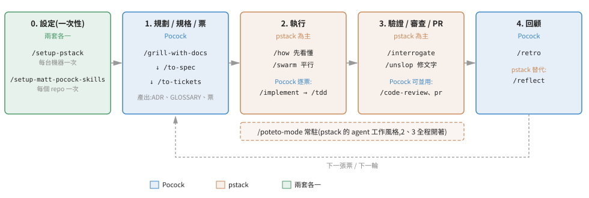
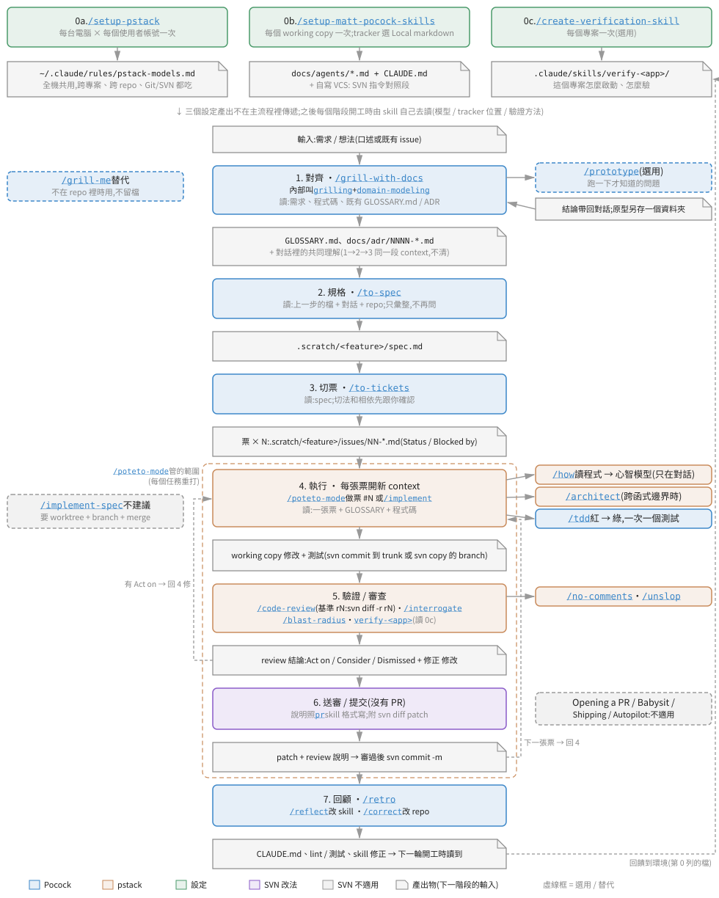

# j-pockit 開發流程:pstack + mattpocock-skills 合用指南

**日期**:2026-10-20    **目的**:一次裝好 pstack 與 mattpocock-skills 兩套 skill;弄懂每個 skill 做什麼、何時用;用它們避開 AI 寫程式的常見痛點;知道兩套怎麼搭著用。

> 本檔是 [workflow.htm](workflow.htm) 的 GitHub 版,在 GitHub 網頁直接點開就能看;內容與 `workflow.htm` 相同。來源:[guru4tw/j-pockit](https://github.com/guru4tw/j-pockit) 的 `docs/workflow.md`。

第一次看:讀第 0 節(安裝 + 一個完整小例子)就能開工。遇到不認得的 skill,點它的名字會跳到[附錄 C](#appendix-c) 那一列,一列講完它做什麼、何時用、限制、誰能叫。其他章節等用到再查。

---

<a id="sec-agenda"></a>
## Agenda(章節導覽)

全篇章節一覽,點任一標題直接跳到該節內容。

- [0. 安裝與快速上手](#sec-0)
  - [0.1 從哪裡拿、怎麼裝](#sec-0-1)
  - [0.2 一個完整小例子:幫 CLI 加 --json 輸出](#sec-0-2)
  - [0.3 只要記住這幾個指令](#sec-0-3)
- [1. 一張圖看懂](#sec-1)
  - [1.1 圖怎麼讀](#sec-1-1)
  - [1.2 Git 流程](#sec-1-2)
  - [1.3 SVN 流程](#sec-1-3)
  - [1.4 每階段讀什麼、產出什麼、交給誰](#sec-1-4)
  - [1.5 設定到底要做幾次](#sec-1-5)
  - [1.6 「先看懂」看的是程式,不是文件](#sec-1-6)
  - [1.7 換到 SVN:哪些照用、哪些要改](#sec-1-7)
- [2. j-pockit 要解決什麼:兩套各補哪個缺口](#sec-2)
- [3. 設定(一次性)](#sec-3)
- [4. 規劃 / 規格 / 票:Pocock](#sec-4)
  - [4.1 主流程](#sec-4-1)
  - [4.2 /grill-with-docs:逼問加留紙本](#sec-4-2)
  - [4.3 /to-spec 與 /to-tickets](#sec-4-3)
  - [4.4 /implement 與 /implement-spec](#sec-4-4)
  - [4.5 模型自己叫的三個:/tdd、/code-review、pr](#sec-4-5)
  - [4.6 支線入口:修 bug、整理 issue、超大工作](#sec-4-6)
  - [4.7 其他 Pocock skill 速查](#sec-4-7)
  - [4.8 context 什麼時候清:階段邊界五選一](#sec-4-8)
- [5. 執行 / 驗證 / 審查:pstack](#sec-5)
  - [5.1 /poteto-mode 怎麼運作](#sec-5-1)
  - [5.2 23 個 playbook 速查](#sec-5-2)
  - [5.3 先看懂:/how、/why、/teach、/recall](#sec-5-3)
  - [5.4 設計:/architect、/arena、/swarm、/interrogate](#sec-5-4)
  - [5.5 寫與清:/unslop、/no-comments、/technical-writing](#sec-5-5)
  - [5.6 驗證:證明做對了](#sec-5-6)
  - [5.7 長跑與夜跑](#sec-5-7)
  - [5.8 換個說法、找路](#sec-5-8)
- [6. 回顧與改進環境](#sec-6)
- [7. pstack 怎麼解 AI 使用者的痛點](#sec-7)
- [8. 別重踩作者的坑](#sec-8)
  - [8.1 pstack 作者列的 14 個坑](#sec-8-1)
  - [8.2 Pocock 列的坑](#sec-8-2)
- [9. 善用技巧](#sec-9)
  - [9.1 prompt 五要素](#sec-9-1)
  - [9.2 用原則名當方向盤](#sec-9-2)
  - [9.3 兩套怎麼接,不打架](#sec-9-3)
  - [9.4 控制成本](#sec-9-4)
- [10. 在 Claude Code + j-pockit 扁平安裝下的差異](#sec-10)
- [11. 情境速查與單 session 捷徑](#sec-11)
- [12. 疑難排解與維護](#sec-12)
  - [12.1 常見狀況](#sec-12-1)
  - [12.2 回復與移除](#sec-12-2)
  - [12.3 這份文件怎麼改、怎麼重產](#sec-12-3)
- [附錄 A. 參考來源(References)](#appendix-a)
- [附錄 B. 技術關鍵字術語表(口語化說明)](#appendix-b)
- [附錄 C. 80 個 skill 一覽](#appendix-c)
  - [C.1 pstack(55 個)](#appendix-c-1)
  - [C.2 Pocock(25 個)](#appendix-c-2)

---

<a id="sec-0"></a>
## 0. 安裝與快速上手

<a id="sec-0-1"></a>
### 0.1 從哪裡拿、怎麼裝

來源是 GitHub [guru4tw/j-pockit](https://github.com/guru4tw/j-pockit)。repo 不放上游 skill 內容,只放安裝腳本、版本鎖和說明;本文件在 repo 的 `docs/workflow.md`(GitHub 上直接看)和 `docs/workflow.htm`(下載後用瀏覽器開,流程圖裡的 skill 可以點)。

需要:Windows、`git`、Windows PowerShell 5.1、Claude Code。

```
git clone https://github.com/guru4tw/j-pockit.git
cd j-pockit
powershell -NoProfile -ExecutionPolicy Bypass -File install.ps1
```

| 參數 | 做什麼 |
|---|---|
| (不帶) | 照 `versions.lock` 釘的版本,把兩套共 80 個 skill 裝到 `~/.claude/skills/`,另裝 pstack 的 `docs/`、兩個 subagent。同名的舊目錄先搬到 `~/.claude/skills_archive/<日期>/`,不刪。 |
| `-Update` | 先查兩個上游的最新版寫回 `versions.lock`,再安裝。lock 有變記得 commit。 |
| `-UserOnly a,b` | 裝完替指定的 skill 在 SKILL.md frontmatter 補一行 `disable-model-invocation: true`,改成只有你能叫。只接受 [`setup-pstack`](#s-setup-pstack)、[`diagnosing-bugs`](#s-diagnosing-bugs)、[`wizard`](#s-wizard)、[`pr`](#s-pr)、[`prototype`](#s-prototype)、[`research`](#s-research) 這 6 個,其他會斷掉 skill 之間的串接,腳本直接拒絕。重裝會把 SKILL.md 換回上游原檔,所以每次重裝都要帶同一組 `-UserOnly`。 |

例:`powershell -NoProfile -ExecutionPolicy Bypass -File install.ps1 -UserOnly pr,wizard`

裝完照順序做三件事:

1. **開新的 Claude Code session**。skill 清單只在 session 啟動時讀一次。
2. 打 [`/setup-pstack`](#s-setup-pstack):這台電腦、這個帳號一次,選 pstack 各角色用哪個模型。
3. 在要開發的 repo 裡打 [`/setup-matt-pocock-skills`](#s-setup-matt-pocock-skills):每個 repo 一次,選 issue tracker(本機沒裝 `gh` 就選 Local markdown)。

<a id="sec-0-2"></a>
### 0.2 一個完整小例子:幫 CLI 加 --json 輸出

情境:repo 裡有個 `report` 指令只印表格,要加 `--json` 輸出。下面是你實際要打的字,`>` 後面是你接著回的話。整個例子只用 6 個 skill。

| 步驟 | 你打 | AI 做什麼 | 你要做的事 |
|---|---|---|---|
| 1 對齊 | `/grill-with-docs report 指令要加 --json 輸出` | 一輪列出待決問題,每題附建議答案:欄位名稱跟表格一樣嗎?空資料印 `[]` 還是 `null`?錯誤訊息走 stdout 還是 stderr?順手把「report」「record」這些詞寫進 `GLOSSARY.md` | 逐題回「同意」或改。答完它會問「理解一致了嗎」,說「一致」 |
| 2 規格 | [`/to-spec`](#s-to-spec) | 不再問問題,把剛才的共識寫成 spec(Local markdown 時是 `.scratch/report-json/spec.md`),先問你測試要放在哪個 seam | 回「測 CLI 的 stdout 就好」 |
| 3 切票 | [`/to-tickets`](#s-to-tickets) | 切成 2 張票:#01 加 `--json` 旗標與輸出、#02 錯誤情況也輸出 JSON;#02 寫明 Blocked by #01 | 看切法,說「OK 發票」 |
| 4 清 context | `/clear` | — | 規劃結束,一手資料都在檔裡了 |
| 5 做票 | `/poteto-mode 做 .scratch/report-json/issues/01-*.md` | 對到 Feature playbook,把步驟抄成待辦;先 [`/how`](#s-how) 看 report 指令怎麼組出表格,再用 [`/tdd`](#s-tdd) 一個測試一個測試寫;最後附實跑 `report --json` 的輸出當證據 | 看它的待辦清單有沒有跳步;看證據 |
| 6 審查 | [`/interrogate`](#s-interrogate) | 派 reviewer 審 diff,結果分 Act on / Consider / Noted / Dismissed | 有 Act on 就說「修 Act on 那幾條」 |
| 7 下一張 | `/clear` 後回到步驟 5 做 #02 | — | — |
| 8 回顧 | [`/retro`](#s-retro) | 讀這次的紀錄,列出環境哪裡可以改(例如「沒有一行指令能跑 CLI 測試,建議加到 CLAUDE.md」) | 挑要做的,叫它改 |

學到的規則就三條:**規劃用 Pocock 寫成檔,執行用 [`/poteto-mode`](#s-poteto-mode) 一張票一個 context,做完要看證據不看口頭保證。**更大的工作只是票變多;更小的改動可以跳過 2、3,直接 [`/grill-with-docs`](#s-grill-with-docs) 後 [`/implement`](#s-implement)。

<a id="sec-0-3"></a>
### 0.3 只要記住這幾個指令

80 個 skill 不用背。日常只需要下面這幾個,其他的要嘛由它們自動拉進來,要嘛等你遇到那個情境再查[附錄 C](#appendix-c)。

| 什麼時候 | 打 |
|---|---|
| 有新想法、需求還模糊 | [`/grill-with-docs`](#s-grill-with-docs) |
| 想法定了,要寫成規格和票 | [`/to-spec`](#s-to-spec) → [`/to-tickets`](#s-to-tickets) |
| 動手做(一張票或一件事) | `/poteto-mode <任務>` |
| 看不懂既有程式 | `/how <問題>` |
| 做完要審 | [`/interrogate`](#s-interrogate)(或 [`/code-review`](#s-code-review)) |
| 東西壞了 | [`/diagnosing-bugs`](#s-diagnosing-bugs) 或 `/poteto-mode repro first: <症狀>` |
| 不知道該叫哪個 | 規劃類問 [`/ask-matt`](#s-ask-matt),執行類問 [`/poteto-help`](#s-poteto-help) |
| 做完回顧 | [`/retro`](#s-retro) |

---
<a id="sec-1"></a>
## 1. 一張圖看懂

分工原則一句話:**想清楚、寫下來、切成票**交給 [mattpocock-skills](#g-mattpocock-skills)(下稱 Pocock);**動手、驗證、審查、出 PR**交給 [pstack](#g-pstack)。pstack 自己的說明就寫明它沒有 planning skill<sup>[[5]](#ref-5)</sup>,所以規劃段用 Pocock<sup>[[2]](#ref-2)</sup>。

兩套 skill 預設的環境是 Git + GitHub。本節先講圖怎麼讀,再分 Git、SVN 兩張圖,接著用一張表把「每階段讀什麼、產出什麼、交給誰」對清楚,最後補三件常被問的細節:設定到底要做幾次、「先看懂」看的是什麼、換成 SVN 時 skill 要不要改。

<a id="sec-1-1"></a>
### 1.1 圖怎麼讀

- **圓角框是 skill**。藍色 Pocock、橘色 pstack、綠色是設定;SVN 圖多了紫色(SVN 改法)和灰色(SVN 不適用)。
- **折角框是產出物**。往下的箭號表示「這個產出物就是下一階段的輸入」。
- 主線右側的小框是該階段內部會拉進來的 skill;左側虛線框是替代路線。
- 第 0 列三個設定的產出不在主線上傳遞,而是之後各 skill 開工時自己去讀的環境檔。
- 兩條虛線回頭箭號:review 有要改的回到 4;做完一張票回到 4 做下一張。最右側的回頭線表示回顧的結果改的是第 0 列的環境。
- [workflow.htm](workflow.htm) 版的圖可以點 skill 名稱跳到詳細說明。GitHub 上的圖不能點,請改用 1.4 的表,表裡每個 skill 都有連結。

<a id="sec-1-2"></a>
### 1.2 Git 流程



圖 1:Git 版。虛線框是 [`/poteto-mode`](#s-poteto-mode) 管的範圍(Claude Code 下它不會一直開著,每個任務要重打,見第 10 節)。

<a id="sec-1-3"></a>
### 1.3 SVN 流程



圖 2:SVN 版。跟 Git 版只差五處,其他照用:

| 位置 | Git | SVN |
|---|---|---|
| 0b tracker | GitHub issue | 選 Local markdown,spec 和票放 [`.scratch/<feature>/`](#g-scratch);`CLAUDE.md` 另加一段 SVN 指令對照(見 1.7) |
| 4 執行 | commit 到 feature branch;可用 [`/implement-spec`](#s-implement-spec) 平行做 | `svn commit`;[`/implement-spec`](#s-implement-spec) 不建議(要 worktree + branch + merge) |
| 5 審查基準 | 某個 SHA 到 `HEAD` | 某個 revision 到 `HEAD`(`svn diff -r rN:HEAD`),叫的時候要講 |
| 6 出貨 | Opening a PR playbook,`gh pr create` | 沒有 PR:照 [`pr`](#s-pr) skill 的格式寫 review 說明,附 `svn diff` patch,審過再 `svn commit` |
| 不適用 | — | Opening a PR、Babysit、Shipping、Autopilot、Orchestrate、Worktree cleanup 這幾套 playbook |

<a id="sec-1-4"></a>
### 1.4 每階段讀什麼、產出什麼、交給誰

這張表是圖的文字版。「讀」欄是該階段的輸入,「產出」欄會出現在下一列的「讀」欄,這就是箭號的意思。

| 階段 | skill | 讀(輸入) | 產出 | 誰接著用 |
|---|---|---|---|---|
| 0a | [`/setup-pstack`](#s-setup-pstack) | 可用模型清單、你選的 budget | `~/.claude/rules/pstack-models.md` | 每個新 session 自動載入;pstack 各角色(`poteto-agent`、[`/arena`](#s-arena) 評審、[`/interrogate`](#s-interrogate) reviewer)照它挑模型 |
| 0b | [`/setup-matt-pocock-skills`](#s-setup-matt-pocock-skills) | `git remote -v`、你回答的三題 | `docs/agents/*.md`、`CLAUDE.md` 的 `## Agent skills` 段 | 1 到 4 的 Pocock skill 開工前讀,知道 spec 和票發到哪、GLOSSARY 在哪 |
| 0c | [`/create-verification-skill`](#s-create-verification-skill) | 專案怎麼啟動、怎麼操作(會實跑一次) | 專案內 `.claude/skills/verify-<app>/` | 5 驗證 |
| 1 | [`/grill-with-docs`](#s-grill-with-docs)(內部叫 [`grilling`](#s-grilling)、[`domain-modeling`](#s-domain-modeling)) | 需求、程式碼、既有 `GLOSSARY.md` / ADR | `GLOSSARY.md`、`docs/adr/NNNN-*.md`、對話裡的共同理解 | 2(1 到 3 要在同一段 context 裡,不清) |
| 1 支線 | [`/prototype`](#s-prototype)(選用) | 一個跑一下才知道答案的問題 | 結論(帶回 1);原型程式另存 branch 或資料夾 | 1 |
| 2 | [`/to-spec`](#s-to-spec) | 1 的對話 + 檔、repo | spec(GitHub issue,或 `.scratch/<feature>/spec.md`) | 3 |
| 3 | [`/to-tickets`](#s-to-tickets) | spec | 票 × N,標 `ready-for-agent`,寫明 Blocked by | 4(一次一張,先挑沒被擋的);3 做完可以 `/clear` |
| 4 | [`/poteto-mode`](#s-poteto-mode) `做票 #N` 或 [`/implement`](#s-implement) | 一張票、`GLOSSARY.md`、程式碼、0a / 0b 的設定 | commit + 測試 | 5;每張票開新 context |
| 4 內 | [`/how`](#s-how) | 程式碼(只讀程式) | 對話裡的解說,不落檔 | 同一段 context 裡接著動手 |
| 4 內 | [`/architect`](#s-architect) | [`/how`](#s-how) 的結果 + 票 | 選定的設計(候選草稿放 worktree 或暫存資料夾) | 接著實作 |
| 4 內 | [`/tdd`](#s-tdd) | 票上講好的 seam | 測試 + 實作 | 4 的 commit |
| 5 | [`/code-review`](#s-code-review)、[`/interrogate`](#s-interrogate)、[`/blast-radius`](#s-blast-radius)、`verify-<app>`、[`/no-comments`](#s-no-comments) | diff(基準點到 `HEAD`)、spec、repo 規範、0c 的驗證 skill | review 結論(Act on / Consider / Noted / Dismissed)、證據 | 有 Act on 回 4 修;沒有就到 6 |
| 6 | Opening a PR playbook + [`pr`](#s-pr) | commit、5 的證據 | PR(Summary / Evidence / Merge Danger) | 人審、merge |
| 7 | [`/retro`](#s-retro)、[`/reflect`](#s-reflect)、[`/correct`](#s-correct) | session 紀錄、commit / revert、review 留言 | `CLAUDE.md` 修改、lint / 測試、skill 修正建議 | 第 0 列的環境,下一輪開工時讀到 |

<a id="sec-1-5"></a>
### 1.5 設定到底要做幾次

[`/setup-pstack`](#s-setup-pstack) 跨專案、跨 repo(Git、SVN 都一樣)都不用再設,但只限**同一台電腦、同一個使用者帳號**。它最後順便問的驗證 skill 是每個專案各一份,不是一次就好。

| 設定 | 寫到哪 | 作用範圍 | 什麼時候要重跑 |
|---|---|---|---|
| `install.ps1` | `~/.claude/skills/`、`docs/`、`agents/` | 這個帳號下所有專案 | 換電腦、換帳號;要更新版本時(`-Update`,或別台 `git pull` 後重跑) |
| [`/setup-pstack`](#s-setup-pstack) | [`~/.claude/rules/pstack-models.md`](#g-pstack-models-md),在家目錄,不在專案裡 | 這個帳號下所有專案、所有 repo | 換電腦或換帳號(檔案不會跟著走);可用模型變了(新模型上線、方案改);想調 budget 或省錢。每次重跑整檔覆寫,開新 session 才生效。沒跑過也能用,各角色用內建預設模型 |
| 驗證 skill([`/setup-pstack`](#s-setup-pstack) 最後一題,或直接叫 [`/create-verification-skill`](#s-create-verification-skill)) | 專案內 `.claude/skills/verify-<app>/` | 只有這個專案 | 每個新專案各建一次;app 改了用 [`/maintain-verification-skill`](#s-maintain-verification-skill) 更新 |
| [`/setup-matt-pocock-skills`](#s-setup-matt-pocock-skills) | 專案內 `docs/agents/`、`CLAUDE.md` | 只有這個 repo | 每個新 repo 一次。這些檔要 commit 進版控,同一個 repo 的其他 checkout 才拿得到,不用重跑 |

依據:`setup-pstack/SKILL.md` 寫明整檔覆寫、「applies to new sessions. Re-running this skill updates it」;寫到家目錄由 pstack adapter 規定<sup>[[6]](#ref-6)</sup>。「換帳號要重跑」是依路徑推論。

<a id="sec-1-6"></a>
### 1.6 「先看懂」看的是程式,不是文件

[`/how`](#s-how) 只讀**程式碼**。它的 SKILL.md 寫的是「Explore the codebase」,派出去的 explorer 都是唯讀,只用 Read / Grep / Glob;SKILL.md 和兩份 prompt 都沒提到 `GLOSSARY.md`、ADR 或 spec<sup>[[10]](#ref-10)</sup>。

- 它在流程的位置:階段 4 開工第一步([`/poteto-mode`](#s-poteto-mode) 的規則是「非小改動先 [`/how`](#s-how)」)。輸入是一張票 + 程式碼;產出是 AI 對這段程式的心智模型,用來決定要改哪裡。
- 輸出固定五段:Overview、Key Concepts、How It Works、Where Things Live、Gotchas。**只在對話裡,不落檔**;要留下來就明講「寫到 `docs/notes/<主題>.md`」。
- 你要確認它看懂了沒,讀 Where Things Live 和 Gotchas 兩段最快:檔案位置對不上、陷阱講不出來,就是還沒懂。

文件和歷史由別的 skill 負責:

| 想弄懂什麼 | 用 | 讀的來源 |
|---|---|---|
| 程式現在怎麼跑、新東西放哪 | [`/how`](#s-how) | 程式碼 |
| 為什麼長這樣、數字哪來的 | [`/why`](#s-why) | `git blame` / `git log`(SVN 是 `svn blame` / `svn log`)、issue、文件、接上的 MCP |
| 專案名詞、過去的決定 | 1 階段留下的 `GLOSSARY.md`、`docs/adr/`;要補就用 [`/grill-with-docs`](#s-grill-with-docs) | 文件 |
| 讓**你**真的懂 | [`/teach`](#s-teach) | 先跑 [`/how`](#s-how) 和 [`/why`](#s-why),再用白話加圖講給你聽 |

<a id="sec-1-7"></a>
### 1.7 換到 SVN:哪些照用、哪些要改

規劃段(0b、1、2、3)只要 tracker 選 Local markdown,幾乎不受影響。受影響的集中在 branch、worktree、PR 三件事<sup>[[10]](#ref-10)</sup>。

| skill | 用到的 Git 功能 | SVN 下怎麼辦 | 結論 |
|---|---|---|---|
| [`/setup-matt-pocock-skills`](#s-setup-matt-pocock-skills) | 讀 `git remote -v` 猜 tracker | 選 Local markdown | 照用 |
| [`/to-spec`](#s-to-spec)、[`/to-tickets`](#s-to-tickets) | 發到 tracker | Local markdown | 照用 |
| [`/triage`](#s-triage) | GitHub issue、PR | 只整理 local issue | 部分照用,PR 那段不適用 |
| [`/wayfinder`](#s-wayfinder) | 研究用 throwaway branch | 改用資料夾 | 照用 |
| [`/implement`](#s-implement) | commit 到目前 branch | `svn commit` | 照用 |
| [`/implement-spec`](#s-implement-spec) | integration branch、每票一個 worktree、merger、draft PR | 沒有便宜的 worktree 和 merge | 不建議,改逐票 [`/implement`](#s-implement) |
| [`/tdd`](#s-tdd) | 無 | — | 照用 |
| [`/code-review`](#s-code-review) | `git diff <基準>...HEAD`、`git log` | `svn diff -r rN:HEAD`、`svn log -r` | 叫的時候講明 SVN 和基準 revision(推測可行,未實測) |
| [`/diagnosing-bugs`](#s-diagnosing-bugs) | `git bisect` | 手動 `svn update -r` 二分 | 照用 |
| [`/prototype`](#s-prototype) | 丟棄式 branch | 另一個資料夾,或 `svn copy` 到 branches | 照用 |
| [`pr`](#s-pr) | 無(只是說明範本) | 拿來寫 review 說明 | **不用改** |
| [`/poteto-mode`](#s-poteto-mode) 一般 playbook(Bug fix、Feature、Refactoring、Investigation、Perf) | commit | `svn commit` | 照用 |
| Opening a PR、Babysit、Shipping、Autopilot、Orchestrate、Worktree cleanup | rebase、force-push、`gh`、worktree | 沒有對應 | 不適用 |
| [`/why`](#s-why)、[`/recall`](#s-recall)、[`/blast-radius`](#s-blast-radius) | `git blame` / `log`、`gh pr view` | `svn blame`、`svn log -v --diff`;沒有 PR 討論可查 | 照用,證據較少,commit message 要寫理由 |
| [`/interrogate`](#s-interrogate)、[`/no-comments`](#s-no-comments) | `git diff main...HEAD` | `svn diff` | 照用,講明基準 |
| [`/arena`](#s-arena)、[`/swarm`](#s-swarm)、[`/figure-it-out`](#s-figure-it-out)、[`/show-me-your-work`](#s-show-me-your-work) | worktree、SHA | 各自資料夾、revision 號 | 照用([`/arena`](#s-arena) 本來就有資料夾備案) |

**skill 要不要改?** 不用改上游的 SKILL.md(j-pockit 的原則是不改上游,見 [ADR 0001](adr/0001-flat-install-not-plugin.md))。建議在 SVN 專案的 `CLAUDE.md` 加一段對照,每個 session 都會讀到,所有 skill 一起換說法:

```markdown
## VCS: SVN
本 repo 用 SVN,沒有 git。skill 裡的 git 操作照下表換:

| git | svn |
|---|---|
| git diff <base>...HEAD | svn diff -r <rN>:HEAD |
| git log / git blame | svn log -v / svn blame |
| commit to current branch | svn commit(commit 前先給我看 diff) |
| PR | 沒有。照 pr skill 的格式寫 review 說明,附 svn diff patch |
| worktree / branch | 需要隔離時另開一個 checkout 目錄 |

不跑 Opening a PR、Babysit、Shipping、Autopilot、Orchestrate、/implement-spec。
```

[`pr`](#s-pr) skill 本身沒有任何 git 指令,不用改。它的觸發描述是「Use when writing a PR body.」,SVN 沒有 PR 就不會自動觸發;要用時明講「用 pr skill 的格式寫這次修改的 review 說明」。

推測:上面的對照段可行,依據是各 skill 只把 git 指令當操作手段,模型讀到 `CLAUDE.md` 會換用;**尚未在 SVN repo 實測**。若實測發現 [`/code-review`](#s-code-review) 堅持跑 git,再考慮在 j-pockit 加一個 SVN 專用的補充 skill。

---

<a id="sec-2"></a>
## 2. j-pockit 要解決什麼:兩套各補哪個缺口

兩套 skill 各自完整,但重心不同。Pocock 強在**人和 AI 先對齊**:把模糊的想法逼問清楚、用同一套名詞、寫成 spec、切成每張都能單獨驗的票。pstack 強在**AI 動手時的紀律**:改之前先看懂、設計多做幾個比較、讓不同模型互相挑錯、做完拿證據、長時間跑留決策紀錄。

| 面向 | Pocock | pstack |
|---|---|---|
| 核心信念 | 先對齊理解;好的[回饋迴圈](#g-feedback-loop)就是 skill 本身 | 做完要能證明;第一個設計通常不是最好的 |
| 叫法 | 使用者叫的 orchestrator,內部再叫[模型自己叫的](#g-model-invoked) discipline | 幾乎全部設了 [`disable-model-invocation`](#g-disable-model-invocation),只能由你打指令,再由 [`/poteto-mode`](#s-poteto-mode) 統一調度 |
| 入口 | [`/ask-matt`](#s-ask-matt):只告訴你該叫哪個,不會替你執行 | [`/poteto-mode`](#s-poteto-mode):挑一套 [playbook](#g-playbook) 照步驟做;[`/poteto-help`](#s-poteto-help):只回答該用哪個 |
| 規劃 | 逼問 → spec → 票 | 刻意沒有;用 prototype 回答問題,設計定了才寫 plan |
| 驗證 | 測試先行 + 兩軸 code review | 看真東西、專案自己的驗證 skill、效能數字七問、影響範圍檢查 |
| 回顧 | 改善 agent 的工作環境 | 把心得改進 skill;讓同一個錯在結構上不可能再犯 |

簡單說:**Pocock 回答「要做什麼、做到哪算完」,pstack 回答「怎麼做才不出包、怎麼證明做對了」。**

j-pockit 做的事很少:把兩套扁平裝進 `~/.claude/skills/`,用短名直接叫([`/how`](#s-how),不是 [`/pstack:how`](#g-plugin-prefix)),版本釘死,並處理三個同名衝突<sup>[[4]](#ref-4)</sup>:

| 名稱 | 裝哪版 | 理由 |
|---|---|---|
| [`/tdd`](#s-tdd) | Pocock | Pocock 的 [`/implement`](#s-implement) 會自動叫 [`/tdd`](#s-tdd);換成 pstack 版這條鏈會斷 |
| [`/teach`](#s-teach) | pstack | pstack 版會串 [`/how`](#s-how)、[`/why`](#s-why) |
| [`/handoff`](#g-handoff) | 都不裝 Pocock 版 | 同名時 skill 會蓋掉本機的 `/handoff` 指令 |

為什麼不用官方 plugin 方式安裝,見 [ADR 0001](adr/0001-flat-install-not-plugin.md)<sup>[[9]](#ref-9)</sup>。

---

<a id="sec-3"></a>
## 3. 設定(一次性)

| 指令 | 頻率 | 做什麼 |
|---|---|---|
| [`/setup-pstack`](#s-setup-pstack) | 每台電腦 × 每個使用者帳號一次,跨專案、跨 repo 共用(細節見 [1.5](#sec-1-5)) | 依可用模型決定每個角色用哪個模型、多少 [reasoning budget](#g-reasoning-budget),寫成 [`~/.claude/rules/pstack-models.md`](#g-pstack-models-md)。最後會問要不要建專案的驗證 skill,**建議答應**(見 5.6)。 |
| [`/setup-matt-pocock-skills`](#s-setup-matt-pocock-skills) | 每個 repo 一次 | 一次問一題、每題附建議答案:(A) [issue tracker](#g-issue-tracker) 用 GitHub、GitLab 還是 repo 內的 markdown;(B) triage label 怎麼叫;(C) domain 文件放哪。結果寫進 [`docs/agents/`](#g-docs-agents),並在既有的 [`CLAUDE.md`](#g-claude-md) 加一段 `## Agent skills`。 |

兩者沒有先後,也不互斥。補充三點:

- [`/setup-pstack`](#s-setup-pstack) 是 pstack 裡唯一模型可以自己叫的 skill。沒跑過也能用,各角色會用 skill 內建的預設模型。
- 選 local markdown 當 issue tracker 時,spec 和票放在 [`.scratch/<feature>/`](#g-scratch),一張票一個檔,檔內有 `Status:`、`Blocked by:` 兩行。
- Pocock v1.3 起 `CONTEXT.md` 改名 [`GLOSSARY.md`](#g-glossary-md),沒有向下相容,舊專案要自己 `git mv`。

---

<a id="sec-4"></a>
## 4. 規劃 / 規格 / 票:Pocock

Pocock 的 skill 分兩種<sup>[[7]](#ref-7)</sup>:你打名字才會跑的 orchestrator,和模型判斷需要時自己叫的 discipline。規則是 orchestrator 可以叫 discipline,反過來不行。所以 [`/grill-with-docs`](#s-grill-with-docs) 本身很薄,真正做事的是它叫的 [`grilling`](#s-grilling) 和 [`domain-modeling`](#s-domain-modeling)。

<a id="sec-4-1"></a>
### 4.1 主流程

| 步驟 | 指令 | 什麼時候 | 產出 |
|---|---|---|---|
| 1 | [`/grill-with-docs`](#s-grill-with-docs)(不在 repo 裡就用 [`/grill-me`](#s-grill-me)) | 有新想法、計畫還模糊 | 共同理解、[ADR](#g-adr)、`GLOSSARY.md` |
| 2(選用) | [`/prototype`](#s-prototype) | 有問題要跑一下才知道答案 | 丟棄式程式 + 結論 |
| 3 | [`/to-spec`](#s-to-spec) | 要跨多個 session 才做得完 | 一份 spec |
| 4 | [`/to-tickets`](#s-to-tickets) | spec 定了 | 一組 [tracer-bullet](#g-tracer-bullet) 票 |
| 5 | [`/implement`](#s-implement)(逐票)或 [`/implement-spec`](#s-implement-spec)(整份平行) | 開工 | commit |
| 6 | [`/retro`](#s-retro) | 做完,尤其做得不順時 | 環境改善建議 |

context 的規矩:步驟 1、3、4 留在同一段不中斷的 context 裡;prototype 另開 session 做,做完把結論帶回來;每個 [`/implement`](#s-implement) 開新的 context。

<a id="sec-4-2"></a>
### 4.2 /grill-with-docs:逼問加留紙本

這是整套最重要的一步。它的做法:

- 把計畫看成一棵決策樹。每一輪把**前置條件都已決定**的那一層問題([frontier](#g-frontier))一次列出來,每題附它建議的答案,你只要逐題回「同意」或改。
- **查事實是 AI 的事,做決定是你的事。**能從程式碼查到的,它派 [subagent](#g-subagent) 去查,不會拿來問你。
- 邊問邊由 [`domain-modeling`](#s-domain-modeling) 更新 `GLOSSARY.md`:挑戰跟術語表衝突的用詞、把含糊的詞說死(「account」到底是 Customer 還是 User)、編邊界情境來測、拿你說的去對程式碼。難回頭又有真實取捨的決定才寫 ADR。
- 問到沒有待決問題才停,而且**你確認理解一致之前不會動手**。

用法提示:用 [`/grill-with-docs`](#s-grill-with-docs) 不要用 [`/grill-me`](#s-grill-me),前者多留了紙本,下一個 session 讀得到。

<a id="sec-4-3"></a>
### 4.3 /to-spec 與 /to-tickets

[`/to-spec`](#s-to-spec) 只做彙整,不再問問題。它先用術語表的名詞讀 repo、遵守既有 ADR,再跟你確認測試要放在哪幾個 [seam](#g-seam)(「越高越少越好,理想是一個」),然後寫出:問題、解法、一長串 user story、實作決定、測試決定、不做什麼。spec 裡**不寫檔案路徑和程式碼**,因為那些很快就過時。

[`/to-tickets`](#s-to-tickets) 把 spec 切成票。每張票是一條從頭打通到尾的細路徑(每一層都碰一點),做完就能展示、能驗,而且一個新 context 裝得下。需要先整理的「prefactoring」排最前面。大範圍重構例外,改用 [expand-contract](#g-expand-contract) 排序。它會跟你來回確認切法和誰擋誰,你點頭才發票,每張標 [`ready-for-agent`](#g-ready-for-agent)。

注意:[`/to-spec`](#s-to-spec) 和 [`/to-tickets`](#s-to-tickets) 會直接發到 issue tracker,選 GitHub 就會開出真的 issue。沒跑過 [`/setup-matt-pocock-skills`](#s-setup-matt-pocock-skills) 時,多數 Pocock skill 會先停下來叫你去跑。

<a id="sec-4-4"></a>
### 4.4 /implement 與 /implement-spec

|  | [`/implement`](#s-implement) | [`/implement-spec`](#s-implement-spec) |
|---|---|---|
| 範圍 | 一張票(或單 session 的整件事) | 整份 spec 的所有票 |
| 誰開車 | 你逐張叫,每張之間 [`/clear`](#g-clear) | AI 當調度者,把票當成任務圖 |
| 做法 | 在事先講好的 seam 用 [`/tdd`](#s-tdd);常跑 typecheck 和單一測試檔,最後跑全套;跑 [`/code-review`](#s-code-review);commit 到目前 branch | 開一條 [integration branch](#g-integration-branch);能做的票各派一個背景 subagent、各用一個 [worktree](#g-worktree);另有一個 merger 收合;全部做完跑 [`/code-review`](#s-code-review) 再修 |
| 適合 | 想自己盯每一步 | 票多、彼此相依清楚,想讓 AI 平行做 |

<a id="sec-4-5"></a>
### 4.5 模型自己叫的三個:/tdd、/code-review、pr

- [`/tdd`](#s-tdd):先寫一個會失敗的測試,再寫剛好讓它過的程式,一個一個來,不先把測試全寫完。測試只放在事先講好的 seam,只在系統邊界(外部 API、時間、亂數)mock,**不 mock 自己的 module**。重構不在這個迴圈裡,交給 code review。介面形狀本身有疑問時會叫 [`codebase-design`](#s-codebase-design)。
- [`/code-review`](#s-code-review):對某個基準點以來的 diff,分兩條軸各派一個 subagent 平行審。**Standards** 軸看 repo 規範(加 12 個 Fowler code smell 當底線),**Spec** 軸看有沒有照原始 spec 做。兩軸結果分開列,不合併排序。基準點(`main` 或某個 SHA)沒給會問你;找不到 spec 就略過 Spec 軸。
- [`pr`](#s-pr):寫 PR 說明時自動套用。三段:最小的一張圖說重點、改前改後的證據(截圖最好,測試輸出次之)、合併風險(能不能回頭、影響多大)。

<a id="sec-4-6"></a>
### 4.6 支線入口:修 bug、整理 issue、超大工作

| 情況 | 指令 | 重點 |
|---|---|---|
| 東西壞了、很慢、測試失敗 | [`/diagnosing-bugs`](#s-diagnosing-bugs) | 第一步一定是建一個能穩定重現失敗、跑得快、AI 自己能跑的回饋迴圈。**沒有能變紅的指令,就不准開始猜原因。**再來是縮小重現、列 3 到 5 個可推翻的假設(測之前先給你看排序,你可以改;你不在就照它的排序)、一次只改一個變數加 log、有合適的 seam 就先寫回歸測試(沒有的話這本身就是發現,要記下來)、清掉 debug log。 |
| issue 堆積 | [`/triage`](#s-triage) | 每個 issue 一個類別(bug / enhancement)、一個狀態(五個標準 label)。先查是否重複、是否已被拒絕過,再重現。AI 發的留言一律加免責聲明。[`/to-tickets`](#s-to-tickets) 產的票不要再 triage。 |
| 超大、霧很濃、一個 session 裝不下 | [`/wayfinder`](#s-wayfinder) | 畫一張由決策票組成的地圖,一個 session 只解一張票(研究票除外)。它只做規劃不做實作,最後回到主流程的 [`/to-spec`](#s-to-spec)。範圍清楚的功能不要用它。 |

<a id="sec-4-7"></a>
### 4.7 其他 Pocock skill 速查

| 指令 | 叫法 | 什麼時候用 |
|---|---|---|
| [`/improve-codebase-architecture`](#s-improve-codebase-architecture) | 你叫 | 有空檔時做架構健檢。產出一份 HTML 報告列出可「加深」的模組,你選一個再進逼問;結果回流 [`/grill-with-docs`](#s-grill-with-docs)。 |
| [`/prototype`](#s-prototype) | 模型叫 | 要驗證狀態邏輯(單一 HTML 檔 + 可點的按鈕)或 UI 長相(同一頁 3 到 5 個結構不同的變體,用 `?variant=` 切)。答案寫進正式程式碼並從 issue 指過去;原型程式碼本身留在 `prototype/<name>` branch 當一手資料。 |
| [`/research`](#s-research) | 模型叫 | 派背景 agent 只查一手來源,寫成一份附引用的 markdown。 |
| [`codebase-design`](#s-codebase-design) | 模型叫 | [deep module](#g-deep-module) 的詞彙與原則:小介面藏大量行為、介面就是測試面。「Design it twice」會派 3 個以上 subagent 各用不同限制設計介面再比較。 |
| [`/to-questionnaire`](#s-to-questionnaire) | 你叫 | 答案在別人腦袋裡時,產一份問卷給對方填。 |
| [`/wait-what`](#s-wait-what) | 你叫 | AI 上一則沒講懂,要它用簡化英文加術語表的詞重講。 |
| [`wizard`](#s-wizard) | 模型叫 | 設 CI secret、第三方後台這類 AI 做不了的手動步驟,產一支一步一步帶你做的 bash 腳本。 |
| [`writing-for-agents`](#s-writing-for-agents) | 模型叫 | 寫給 agent 讀的文件(skill、`CLAUDE.md`)的寫法參考;[`/retro`](#s-retro) 會用到。 |

<a id="sec-4-8"></a>
### 4.8 context 什麼時候清:階段邊界五選一

Pocock 把 context 管理當成流程的一部分。只在[階段邊界](#g-phase-boundary)做決定,照順序問,第一個「是」就照做:

1. **繼續**:下一階段需要這段對話當一手資料,或 [smart zone](#g-smart-zone)(約 150k token)還夠。
2. `/clear`:目前的 context 跟下一步無關。
3. `/handoff`:換工具、換目錄、交給同事,或中途分出一條支線。
4. subagent:那件事 AI 自己做得完。
5. [`/compact`](#g-compact):預設選項,但不是第一個想到的。

理由:除了「繼續」,其他做法都會把一手資料變成有損的摘要。**階段中途 compact 最傷**,新 session 會很有自信地照著被壓扁的摘要做錯。

---

<a id="sec-5"></a>
## 5. 執行 / 驗證 / 審查:pstack

pstack 是 Lauren Tan(poteto)的工作方式<sup>[[1]](#ref-1)</sup><sup>[[5]](#ref-5)</sup>。幾乎每個 skill 都要你親手打指令;實務上你只要記住一個入口 [`/poteto-mode`](#s-poteto-mode),其他 skill 由它在需要時拉進來。

<a id="sec-5-1"></a>
### 5.1 /poteto-mode 怎麼運作

1. 讀 Claude Code 的 [adapter](#g-adapter),把 Cursor 的工具名、模型名換成這裡的。
2. 把你的任務對到 23 套 playbook 之一,**把那套的步驟原樣抄成待辦清單**。跳過的步驟要寫 `skip: <理由>`,所以你看得到它省略了什麼。都對不上或範圍很大時,改走 [`/figure-it-out`](#s-figure-it-out) 現場設計一套。
3. 依觸發表自動拉其他 skill:非小改動先 [`/how`](#s-how);程式碼跨函式邊界就 [`/architect`](#s-architect);設計有爭議就 [`/interrogate`](#s-interrogate);寫文字套 [`/unslop`](#s-unslop);review 前跑 [`/no-comments`](#s-no-comments);有效能數字就 [`/benchmark-checklist`](#s-benchmark-checklist);長時間或無人看管就 [`/show-me-your-work`](#s-show-me-your-work)。
4. 套用到的每條 [principle](#g-principle),回覆裡要點名,並說它改變了哪個決定。
5. 可回頭的工作直接做不問你;只在 force-push 共用 branch、部署、刪資料、對客戶發訊息前停下來。要問你「選哪個做法」之前,跑一下就知道答案的先用 prototype 回答。它也被要求該反對時就反對。
6. 分派 subagent 用 [`poteto-agent`](#g-poteto-agent),每件事開新的,主 agent 要親自看過每個 diff。
7. 回覆風格:短句、不用破折號、每個說法標明是量到的、推論的還是猜的。

<a id="sec-5-2"></a>
### 5.2 23 個 playbook 速查

你不必背 playbook 名字,用平常的話描述任務,[`/poteto-mode`](#s-poteto-mode) 會自己對。下表方便你知道有哪些路可走,以及用什麼說法會被導到那裡。

| 類別 | playbook | 做什麼 / 觸發說法 |
|---|---|---|
| 弄清楚 | Investigation | 唯讀調查,附引用的答案。說「don't change any code yet」。 |
| 弄清楚 | Runtime forensics | 對活著的程式加量測,不靠讀原始碼猜。 |
| 弄清楚 | Trace forensics | 從已抓到的 profile、trace、heap snapshot 診斷。 |
| 弄清楚 | Session pickup | 接手別人(或上週的你)做到一半的 branch,讀決策紀錄,不重做已完成的。 |
| 改程式 | Bug fix | 先在真實介面重現,用執行期證據找根因,再修。說「repro first」。 |
| 改程式 | Feature | 從具名的資料形狀開始做新功能。 |
| 改程式 | Refactoring | 結構變、行為不變。說「zero behavior change」。 |
| 改程式 | Perf issue | 每個修正都要對到 baseline 量測。 |
| 改程式 | Hillclimb | 對一個指標持續改進:假設、改、量、記錄,每個進步一個 commit。 |
| 改程式 | Visual parity | 新舊畫面要一模一樣,用影像比對判定。 |
| 設計與規劃 | Prototype | 丟棄式草稿回答設計問題,附截圖或時間給你比。 |
| 設計與規劃 | Multi-phase plan | 設計定了之後寫 plan:一個 PR 一節,每節結尾是證明它有效的方法。只寫不做。 |
| 出貨 | Opening a PR | 每套 playbook 結尾都跑,開 PR。 |
| 出貨 | Babysit | 把 PR 顧到可合併(review thread、CI)。遇到衝突只回報哪條 branch 要 rebase,不自己解。 |
| 出貨 | Shipping | 每個 PR 單獨驗,只合從根算起連續驗過的那段。 |
| 出貨 | Autopilot-full | 一串互不相依的 PR,各有負責的 subagent 從建到合。 |
| 出貨 | Autopilot-stack | 一條線性堆疊的 PR,交給你審和合。 |
| 長跑 | Autonomous run | 給一個可檢查的完成條件,一路做到條件成立。 |
| 長跑 | Orchestrate | 跨好幾天、很多 PR 的大計畫,一個調度者管一群 subagent。 |
| 長跑 | Pause safely | 你說要暫停時,收尾或退回目前這步、存檔、寫接手說明。 |
| 維護 | Authoring a skill | 寫新 skill。「拿不準就刪」。 |
| 維護 | Eval | 改 skill 或 prompt 前先做盲測實驗,避免「知道在被測」影響結果。 |
| 維護 | Worktree cleanup | 清掉已合併或放棄的 worktree。 |

23 套都對不上時,[`/poteto-mode`](#s-poteto-mode) 改叫 [`/figure-it-out`](#s-figure-it-out) 現場設計一套。

<a id="sec-5-3"></a>
### 5.3 先看懂:/how、/why、/teach、/recall

AI 出錯通常是兩種:誤會你要什麼,或缺 context 就動手。這四個解第二種,而且都逼 AI 用你能檢查的話解釋自己<sup>[[5]](#ref-5)</sup>。

| 指令 | 回答什麼 | 做法 | prompt 範例 |
|---|---|---|---|
| [`/how`](#s-how) | 程式現在怎麼跑、新東西該放哪 | 小問題直接讀;大子系統先派 2 到 4 個唯讀 explorer 分頭看,再由一個 explainer 整合。輸出:概觀、關鍵概念、流程、東西在哪、陷阱。 | `/how do we dedupe notifications?` |
| [`/why`](#s-why) | 為什麼長這樣、這個數字哪來的 | 從 git blame / log 起頭,再依你接了哪些 [MCP](#g-mcp) 平行查 issue、文件、聊天、監控等 7 類證據。分開「直接證據」和「推論」,查無結果也照實報。 | `/why was the retry limit set to five?` |
| [`/teach`](#s-teach) | 讓你真的懂 | 跑 [`/how`](#s-how) 和 [`/why`](#s-why),用白話加逐步長大的圖解釋。加一句「convince me」,解釋就變成你能檢驗的論證。 | `/teach me how this PR changes retries. convince me it fixes the cause.` |
| [`/recall`](#s-recall) | 你自己最近做到哪 | 翻你最近的對話紀錄、PR、branch,整理成現況、各線狀態、問題、下一步。 | `/recall catch me up on the export work from last week` |

坑:別因為「AI 反正會讀程式」就跳過這步。沒先建好心智模型就動手,常會在第一個看起來合理的地方修症狀。

<a id="sec-5-4"></a>
### 5.4 設計:/architect、/arena、/swarm、/interrogate

- [`/architect`](#s-architect):先跑 [`/how`](#s-how)(搬動擁有權時加 [`/why`](#s-why))打底,再用 [`/arena`](#s-arena) 產出至少兩個結構不同的設計草稿,每個都先寫「呼叫端怎麼用」,再寫型別與簽名。預設設計完直接實作;要先看設計就說「with checkpoint」。實作中如果到處出現同樣的繞路、只能靠 `any` 或強制轉型才編得過,它會當成設計錯了,砍掉重來。
- [`/arena`](#s-arena):N 個 subagent 做同一份題目,各寫在自己的目錄或 worktree;一個唯讀評審(盡量用不同[模型家族](#g-model-family))照評分表打分;主 agent 選一個當底,再從每個落選者嫁接一兩個好點子(候選收斂時就不用嫁接),最後驗證。決定很貴時就要求更多候選。
- [`/swarm`](#s-swarm):把工作切成互不相干的片,一片一個 worker,各回 PASS / ISSUES / BLOCKED,最後一份報告。缺結果算缺口,不算通過。**要覆蓋面用 swarm,要比設計用 arena。**
- [`/interrogate`](#s-interrogate):把同一個 diff 交給不同模型家族的 reviewer。重點是模型差異,不是角色扮演;兩個模型各自都抓到的問題最可信。主 agent 把結果分成 Act on / Consider / Noted / Dismissed,每個駁回都附理由,**不會自動套用**。駁回的也要看,你可以推翻。

多少設計工作才夠?pstack 給的[設計階梯](#g-design-ladder)<sup>[[5]](#ref-5)</sup>:

| 情況 | 用 |
|---|---|
| 小改動、做完了但不放心 | 只跑 [`/interrogate`](#s-interrogate) |
| 跨函式邊界或搬擁有權 | [`/architect`](#s-architect)(會帶上 [`/arena`](#s-arena)) |
| 單一決定:命名、格式、演算法 | 直接 [`/arena`](#s-arena) |
| 覆蓋矩陣、平行檢查、競速 | [`/swarm`](#s-swarm) |
| 跑一下就知道答案的問題(版面、時間、做法) | prototype,不要辯論 |
| 有爭議、事後很難改的設計 | [`/architect`](#s-architect),出貨前再 [`/interrogate`](#s-interrogate) |
| 跨好幾個 PR | 設計定了之後寫 plan |

[`/poteto-mode`](#s-poteto-mode) 已經會照這個階梯自動做。你直接叫它們,通常是想要比預設更多或更少的檢查。

<a id="sec-5-5"></a>
### 5.5 寫與清:/unslop、/no-comments、/technical-writing

- [`/tdd`](#s-tdd):j-pockit 裝的是 Pocock 版(見 4.5)。pstack 的 Bug fix playbook 說「用 tdd skill」時,拿到的就是這一版。
- [`/unslop`](#s-unslop):依一份編號清單刪掉 AI 腔,例如誇張詞彙、破折號、句中冒號、粗體開頭的條列、聊天機器人用語、抽象比喻名詞。[`/poteto-mode`](#s-poteto-mode) 每則回覆都會套。
- [`/no-comments`](#s-no-comments):review 前派 [`comment-sicko`](#g-comment-sicko)(一個痛恨註解的 subagent)掃 diff。主 agent 會審它的判斷;描述限制的註解,會提議改成型別、執行期檢查、測試或 lint;你同意就改完再刪註解,不同意也照刪,並回報這個限制還沒有被保護。
- [`/technical-writing`](#s-technical-writing):文件、RFC、README、PR 說明、commit message。一份文件只選一種模式(教學、操作、參考、解說),目標是「累了的工程師第一遍就看懂」。
- [`/typescript-best-practices`](#s-typescript-best-practices):只在讀寫 `.ts` / `.tsx` 時有用的 TypeScript 規則表(discriminated union、不用 `as`、窮舉檢查等)。

<a id="sec-5-6"></a>
### 5.6 驗證:證明做對了

pstack 最核心的一條原則是 [prove-it-works](#s-principles):看真正的東西,不看替代指標;「編得過」「測試綠了」都不算證明。驗證失敗時,先懷疑是觀察方法錯了。

| 指令 | 做什麼 | 結果 |
|---|---|---|
| [`/create-verification-skill`](#s-create-verification-skill) | 為專案產生 [`verify-<app>`](#g-verify-app) skill:怎麼啟動、怎麼自檢、怎麼操作、怎麼留證據、怎麼收拾,外加一份功能地圖。它會實際跑一遍確認證據留得下來。[`/setup-pstack`](#s-setup-pstack) 跑完會主動提議做這一步。 | 專案內的 skill 目錄 |
| [`/maintain-verification-skill`](#s-maintain-verification-skill) | App 改了,功能地圖就會過時。逐項重驗、補漏 | clean / changed / blocked 三選一 |
| [`/create-formal-verification-skill`](#s-create-formal-verification-skill) | 併發、重試、狀態機、parser 這類測試很難碰到的性質,用 [TLA+](#g-tla) 之類做形式驗證。之後程式改了,用 [`/maintain-formal-verification-skill`](#s-maintain-formal-verification-skill) 同步模型重跑 | 形式模型 + 檢查腳本 |
| [`/benchmark-checklist`](#s-benchmark-checklist) | 回報或依效能數字行動前問 7 題:為什麼不是兩倍?有調過嗎?有超限嗎?有出錯嗎?能重現嗎(交替跑 5 次以上)?端到端有差嗎?工作真的有做嗎? | 變快 / 變慢 / 沒有可量測差異 / 無法判定,附數字、單位、次數、範圍、瓶頸 |
| [`/blast-radius`](#s-blast-radius) | 小 diff 不放心時,找它會在別處弄壞什麼。重點不是列呼叫者,而是 grep 找不到的那種(版本、時序、wire format、DB 欄位、feature flag),並找出「它安全是因為哪一個事實」,寫腳本跑真程式證明 | 風險清單(含 `file:line`)、已排除項、合併前要做的事 |

<a id="sec-5-7"></a>
### 5.7 長跑與夜跑

能自己驗證的 agent,才能放著讓它跑。放手前先確認四件事都成立<sup>[[5]](#ref-5)</sup>:

1. 你自己做過一次,或看 agent 做過一次,知道「好」長什麼樣。
2. agent 有你會用的工具和訊號:驗證 skill、profiler、log。
3. 每個階段都會證明自己的成果,不達標能讓整條線停下。
4. 你讀過幾份紀錄,並把重複出現的失敗做成工具、skill 或檢查。

還沒全成立就在旁邊看著跑。夜跑的交代要有:目標、可判定的完成條件(「done means ...」)、獨立的 worktree、事先給的權限(「don't ask me before committing」)、卡住時的出口(「truly stuck 就停下寫原因」),最後用 [`/loop`](#g-loop) 跑到條件成立。

- [`/figure-it-out`](#s-figure-it-out):先寫出可推翻的完成條件,把工作切成最小單位、風險最高的先做,驗證工具和 baseline 先建。每圈:假設、最小改動、量、留或退。
- [`/show-me-your-work`](#s-show-me-your-work):每個決定記一列到 [`decisions.tsv`](#g-decisions-tsv)(時間、階段、決定、理由、證據、結果),只追加不改,預設只留在本機不 commit。結束時先對照紀錄自我稽核,再請不同模型的 reviewer 看。早上用 `/show-me-your-work catch me up on what you did last night` 驗收。
- 迴圈的節奏:一次改一個東西、驗一次、記一列。沒幫助的改動丟掉。完成條件不准偷偷放寬。

<a id="sec-5-8"></a>
### 5.8 換個說法、找路

| 指令 | 用途 |
|---|---|
| [`/poteto-help`](#s-poteto-help) | 問「該用哪個 skill」,它只回答,不開工。 |
| [`/sharpen`](#s-sharpen) | 把你的 prompt 改得更深(頂尖專家會補什麼、最原始的資料、具體方法、外部檢查),只回 prompt,不做事。 |
| [`/in-your-own-words`](#s-in-your-own-words) | 開工前要 AI 用自己的話講一遍你的目標和問題,確認沒誤會。 |
| [`/bro`](#s-bro) | 把上一則用白話重講。 |
| [`/ketchup`](#s-ketchup) | 你離開一下回來:只整理這個對話自你上次發言後發生的事,並列出每件等你決定的事,附它的建議和風險。 |

---

<a id="sec-6"></a>
## 6. 回顧與改進環境

| 指令 | 哪套 | 改的對象 | 做法 |
|---|---|---|---|
| [`/retro`](#s-retro) | Pocock | agent 的工作環境 | 讀這次 session 的紀錄,從 7 類找改進:導航、自動檢查、coding standard、全域 `CLAUDE.md`、工具使用、沒作用的指示(寫了也不改變 agent 行為的規則)、資訊取得。依嚴重度排。 |
| [`/reflect`](#s-reflect) | pstack | skill 本身 | 派三個 reviewer 掃這次對話,整合成 Accepted / Rejected / Backlog,**等你批准**才改 skill。 |
| [`/correct`](#s-correct) | pstack | repo 結構 | 從 commit、revert、review 留言找 agent 一再犯的錯(發生兩次才算一類),在能擋住它的最高層修:架構 → 型別 → lint → 測試,文件最後。每類一個 commit,並證明新檢查能抓到過去真實的錯。 |
| [`/automate-me`](#s-automate-me) | pstack | 你的個人模式 | 從你的對話紀錄歸納工作習慣,產一個你自己的 `<handle>-mode` skill,照 [`/poteto-mode`](#s-poteto-mode) 的形狀。 |

建議用法:做完不順先 [`/retro`](#s-retro);同一個錯第二次出現就 [`/correct`](#s-correct);覺得某個 skill 本身寫得不好用 [`/reflect`](#s-reflect);用一陣子後跑 [`/automate-me`](#s-automate-me)。另外,**不要在任務做到一半時改 skill**,改了要用 Eval playbook 先測。

---

<a id="sec-7"></a>
## 7. pstack 怎麼解 AI 使用者的痛點

pstack 的做法是把「人得一直盯著的事」寫成 skill 裡固定會跑的步驟。下表左欄是用 AI 寫程式常見的痛,右兩欄是 pstack 的對應。

| 痛點 | pstack 的解法 | 機制 |
|---|---|---|
| AI 誤會你要什麼 | prompt 五要素(9.1)、[`/in-your-own-words`](#s-in-your-own-words)、[`/sharpen`](#s-sharpen) | 開工前把目標和[完成條件](#g-done-check)說死,再讓 AI 複述 |
| 不懂既有程式就動手,修到症狀 | [`/how`](#s-how)、[`/why`](#s-why);Investigation playbook | 非小改動一律先建心智模型;說「don't change any code yet」只出調查結果 |
| 第一個設計就定案 | [`/architect`](#s-architect)、[`/arena`](#s-arena)、prototype | 多個候選、交叉評審、選底再嫁接;能跑的問題用跑的回答 |
| 同一個模型自己審自己,盲點一樣 | [`/interrogate`](#s-interrogate) | 不同模型家族各審一次,兩邊都抓到才是強訊號;駁回要附理由 |
| 「build 綠了」就說完成 | prove-it-works、`verify-<app>` | 對真正的產物驗證,檢查寫成可重跑的腳本 |
| 效能數字不可信 | [`/benchmark-checklist`](#s-benchmark-checklist) | 七問找瓶頸、排除量錯東西 |
| 小改動在別處炸開 | [`/blast-radius`](#s-blast-radius) | 找出「安全靠的那一個事實」並跑程式證明 |
| 文字一股 AI 腔、註解氾濫 | [`/unslop`](#s-unslop)、[`/no-comments`](#s-no-comments) | 編號規則逐條掃;另派 subagent 專挑註解 |
| 長跑回來不知道 AI 做了什麼決定 | [`/show-me-your-work`](#s-show-me-your-work) | 每個決定一列紀錄 + 異模型 review |
| 離開一下就跟不上 | [`/ketchup`](#s-ketchup)、[`/recall`](#s-recall)、Session pickup | 只整理你沒看到的部分,並列出等你決定的事 |
| 同一個錯一直手動糾正 | [`/correct`](#s-correct)、encode-lessons-in-structure 原則 | 重複的提醒改成 lint、型別、測試,而不是多寫一段說明 |
| 主對話被大量輸出塞爆 | guard-the-context-window 原則 | 大量讀檔交給 subagent,主對話只留結論 |
| AI 一直問「要繼續嗎?」 | never-block-on-the-human 原則 | 可回頭的事直接做完再給你看;只在不可逆的事前停 |
| 不知道該叫哪個 skill | [`/poteto-mode`](#s-poteto-mode)、[`/poteto-help`](#s-poteto-help) | 由 playbook 決定步驟,你只描述任務 |

---

<a id="sec-8"></a>
## 8. 別重踩作者的坑

<a id="sec-8-1"></a>
### 8.1 pstack 作者列的 14 個坑

這些是 pstack 指南最後一頁整理的常見錯誤<sup>[[5]](#ref-5)</sup>,右欄是改法。

| # | 坑 | 為什麼會出事 | 改成這樣 |
|---|---|---|---|
| 1 | 在 prompt 裡列一堆 skill 名 | 打亂 playbook 已經排好的步驟順序 | 只講目標和完成條件,讓它挑 |
| 2 | 完成條件模糊(「弄好一點」) | 它不知道何時停,或隨便停 | 寫成能判 pass / fail 的條件 |
| 3 | 先講你對原因的猜測 | AI 被帶著走,去修你猜的地方 | 先請它複述問題,再說你的猜測 |
| 4 | 接受第一個設計 | 鎖死錯的形狀 | 要幾個方案;[`/arena`](#s-arena) 或 prototype |
| 5 | 打磨沒有程式支撐的 plan | reviewer 會發明永遠不會發生的風險 | prototype 先,plan 最後;[`/interrogate`](#s-interrogate) 用在 diff 上 |
| 6 | 多個平行 agent 共用一個 worktree | 互相覆蓋檔案 | 一個 worker 一個 worktree |
| 7 | 還沒信任就開 loop 跑一夜 | 錯的工作做得更快,越滾越大 | 四個條件(5.7)成立才放手 |
| 8 | 相信沒檢查過的數字 | 可能量到別的東西 | [`/benchmark-checklist`](#s-benchmark-checklist) |
| 9 | 同一個錯一直手動糾正 | 下次換個 session 照犯 | [`/correct`](#s-correct) |
| 10 | 拿 [`/arena`](#s-arena) 做覆蓋檢查 | 工具用錯,白花錢做選底嫁接 | 覆蓋用 [`/swarm`](#s-swarm) |
| 11 | 每條 review 意見都接受 | reviewer 不是神,會誤判 | 看 [`/interrogate`](#s-interrogate) 的分類和駁回理由,自己判 |
| 12 | 把 [`auto`](#g-auto) 當成模型名 | 它不是某個模型 | 在 Claude Code 下等於不指定模型、用 session 的模型 |
| 13 | build 綠了就回報成功 | 沒看到真正的行為 | 對真產物驗證,附證據 |
| 14 | 憑手感寫 SKILL.md | 寫出 agent 不照做的 skill | 走 Authoring a skill playbook,改前用 Eval 測 |

<a id="sec-8-2"></a>
### 8.2 Pocock 列的坑

- 階段中途 `/compact`,新 session 會照被壓扁的摘要做錯。只在階段邊界決定(4.8)。
- 對 [`/to-tickets`](#s-to-tickets) 產的票再跑 [`/triage`](#s-triage)。
- 範圍清楚的功能用 [`/wayfinder`](#s-wayfinder);或把地圖直接丟給 [`/implement`](#s-implement),跳過 [`/to-spec`](#s-to-spec)。
- 沒有能變紅的回饋迴圈就開始猜 bug 原因。回歸測試放在太淺的 seam,只換來假的安心。
- mock 自己的 module、測實作細節、先把測試全寫完再寫程式。
- spec、票裡寫檔案路徑和程式碼;`GLOSSARY.md` 寫實作細節。
- 寫給 agent 的文件用否定句(「不要想大象」反而會想);用正面描述目標。

---

<a id="sec-9"></a>
## 9. 善用技巧

<a id="sec-9-1"></a>
### 9.1 prompt 五要素

| 要素 | 說明 | 例 |
|---|---|---|
| 目標 | 要達成什麼 | 背景工作每幾小時就 timeout,要找出原因 |
| 完成條件 | 能判 pass / fail | done means 連跑 24 小時零 timeout |
| 要看到的證明 | 你要什麼證據才信 | 給我用了哪些資料、各假設的證據 |
| 已知的事 | 你手上有的事實,不是猜測 | 上週升級 DB driver 後開始 |
| 真正的限制 | 不能違反的事 | repro first / don't change any code yet / zero behavior change / let me review before proceeding |

不要寫「怎麼做」和「你猜的原因」。換任務時說「new task」讓它重挑 playbook。後續追問用短句就好,例如「do it」「continue」。

<a id="sec-9-2"></a>
### 9.2 用原則名當方向盤

pstack 的 24 條原則各是一個 skill,[`/poteto-mode`](#s-poteto-mode) 每次會讀索引、套用、在回覆點名。你覺得它方向偏了,直接在 prompt 裡點原則名就能修正,比長篇解釋有效。

| 類別 | 原則(點名時用英文) | 一句話 |
|---|---|---|
| 核心 | Laziness Protocol | 偏向刪除和最小改動 |
| 核心 | Foundational Thinking | 先把核心型別和資料結構做對 |
| 核心 | Redesign from First Principles | 新需求要當成第一天就有來整合 |
| 核心 | Attack the Premise | 同一前提的修法連敗兩次,就去驗前提本身 |
| 核心 | Subtract Before You Add | 先刪死碼和多餘檢查,再往上加 |
| 核心 | Minimize Reader Load | 少層、少隱藏狀態 |
| 核心 | Outcome-Oriented Execution | 重寫時直奔目標架構,不留過渡相容層 |
| 核心 | Experience First | 使用者體驗優先於實作方便 |
| 核心 | Exhaust the Design Space | 沒前例的設計做 2 到 3 個原型比較 |
| 核心 | Build the Lever | 做工具(腳本、codemod)來完成或證明工作 |
| 架構 | Model the Domain | 分支多的邏輯用狀態機、表格等結構表達 |
| 架構 | Boundary Discipline | 在系統邊界檢查,內部信任型別 |
| 架構 | Type System Discipline | 讓不合法狀態無法表示 |
| 架構 | Make Operations Idempotent | 重跑、當掉後重試,結果都一樣 |
| 架構 | Migrate Callers Then Delete Legacy APIs | 一次搬完呼叫者並刪舊 API |
| 架構 | Separate Before Serializing Shared State | 多個寫入者先拆開,真的必要才排隊 |
| 驗證 | Prove It Works | 對真產物驗證 |
| 驗證 | Fix Root Causes | 追到第一個出錯的地方修 |
| 驗證 | Sequence Work into Verifiable Units | 切成小單位,每個結尾都有檢查 |
| 驗證 | Test Behavior Not Implementation | 測使用者看得到的行為 |
| 驗證 | Explain the Number | 信數字前先找出它的瓶頸 |
| 分派 | Guard the Context Window | 大量輸出交給 subagent |
| 分派 | Never Block on the Human | 可回頭的事不要停下來問 |
| 元 | Encode Lessons in Structure | 教訓寫成檢查,不寫成更多文字 |

<a id="sec-9-3"></a>
### 9.3 兩套怎麼接,不打架

- **逼問和 prototype 分工**:Pocock 的逼問處理只有人能回答的問題(意圖、名詞、取捨);pstack 的 prototype 處理跑一下就知道的問題。兩個都用,不要拿 prototype 問意圖,也不要逼問一個跑一下就知道的問題。
- **spec 不要 [`/interrogate`](#s-interrogate)**:pstack 作者明講抽象的 plan 不值得花 reviewer;它該用在 diff 上。spec 的品質靠逼問和 [`/to-tickets`](#s-to-tickets) 的確認環節。
- **pstack 沒有 planning,Pocock 補上**:多 PR 的工作,先 Pocock 逼問 + spec + 票;每張票開工時打 `/poteto-mode 做票 #N`,讓 pstack 的 playbook 接手執行與驗證。
- **兩種 review 可以都跑**:Pocock [`/code-review`](#s-code-review) 看「合不合規範、合不合 spec」;pstack [`/interrogate`](#s-interrogate) 看「不同模型能不能把它弄壞」。前者對齊意圖,後者找 bug。
- **修 bug 選一條**:[`/diagnosing-bugs`](#s-diagnosing-bugs) 強在先建回饋迴圈、假設清單;[`/poteto-mode`](#s-poteto-mode) 的 Bug fix playbook 強在執行期證據和分派。推測:單機能重現的用前者,要在真實環境量測的用後者。
- **回顧兩個都有用**:[`/retro`](#s-retro) 改環境,[`/reflect`](#s-reflect) 改 skill,[`/correct`](#s-correct) 改 repo。

<a id="sec-9-4"></a>
### 9.4 控制成本

- [`/setup-pstack`](#s-setup-pstack) 選小一點的 budget。
- 不重要的角色用 `auto` 或 [`inherit-parent`](#g-inherit-parent),也就是跟著 session 的模型。
- [`/arena`](#s-arena)、[`/interrogate`](#s-interrogate) 少開幾個候選或 reviewer。
- [`/poteto-mode`](#s-poteto-mode) 留給真的需要嚴謹的工作,小事直接講。

---

<a id="sec-10"></a>
## 10. 在 Claude Code + j-pockit 扁平安裝下的差異

pstack 原本寫給 Cursor,Claude Code 版靠 adapter 對應<sup>[[6]](#ref-6)</sup>。j-pockit 又改成扁平安裝,所以有些地方跟 pstack 文件寫的不一樣。標「推測」的是依檔案推論、尚未實測。

| 項目 | pstack 文件寫的 | 在這裡實際 |
|---|---|---|
| 叫 pstack skill | 打 `/name` | Claude Code 的 [Skill tool](#g-skill-tool) 會拒絕設了 `disable-model-invocation` 的 skill,所以 AI 不能自己叫,要你打。skill 之間靠「讀對方的 SKILL.md 照做」串起來<sup>[[3]](#ref-3)</sup>。 |
| 指令名 | adapter 叫 AI 告訴你打 `/pstack:<name>` | 扁平安裝下是短名 `/name`。AI 若叫你打 `/pstack:how`,改打 [`/how`](#s-how)(推測)。 |
| subagent 名 | `pstack:poteto-agent`、`pstack:comment-sicko` | agent 檔裝在 `~/.claude/agents/`,名稱是 `poteto-agent`、`comment-sicko`(推測)。 |
| [`/poteto-mode`](#s-poteto-mode) 常駐 | Cursor 可設成 [Custom Mode](#g-custom-mode),每輪自動套用 | Claude Code 沒有這功能,每個新任務開頭都要打 [`/poteto-mode`](#s-poteto-mode)<sup>[[1]](#ref-1)</sup>。 |
| 模型 | `claude-opus-5-5-xhigh`、grok、gpt 等 | Claude 模型換成 `opus xhigh` 這種寫法;非 Claude 的模型名一律改用 session 模型。 |
| 「不同模型家族」 | [`/interrogate`](#s-interrogate)、[`/arena`](#s-arena) 評審、[`/show-me-your-work`](#s-show-me-your-work) 都靠模型差異 | 只有 Claude 模型時差異變小。可在 `pstack-models.md` 讓 reviewer 用 sonnet、haiku 等不同模型拉開(推測)。 |
| cloud agent | `environment: cloud` | 改用 worktree 隔離。 |
| Cursor 專屬功能 | Automations、Bugbot、cloud agent 後台 | 跳過,回覆會出現一行 [`Skipped in Claude Code: ...`](#g-skipped-line)。[`/make-bot-ui`](#s-make-bot-ui) 幾乎整個不能用。 |
| 開 PR | 內建 PR 工具 | 改用 `[gh](#g-gh) pr create`。**本機沒裝 `gh`**,要先裝,或自己在網頁開 PR。 |
| [`create-skill`](#g-create-skill) | Cursor 內建,[`/reflect`](#s-reflect)、[`/automate-me`](#s-automate-me)、Authoring a skill 會叫 | 不存在。改用 [`writing-for-agents`](#s-writing-for-agents) 當寫法參考(推測)。 |
| [`/deslop`](#g-deslop) 等 | 屬 cursor-team-kit | 沒裝,相關步驟會跳過。 |
| `/loop` | Cursor 內建的喚醒機制 | Claude Code 也有 `/loop`,細節可能不同(推測)。 |
| tdd / teach / handoff | pstack 有自己的 [`tdd`](#s-tdd);Pocock 主流程會用 `/handoff` 把 prototype 分出去 | [`/tdd`](#s-tdd) 是 Pocock 版;[`/teach`](#s-teach) 是 pstack 版;`/handoff` 是本機自己的指令,不是 Pocock 版。要跑 prototype 可直接在同一個 session 叫 [`/prototype`](#s-prototype)(推測)。 |
| [`/benchmark-checklist`](#s-benchmark-checklist) 的工具 | `uptime`、`nproc` 等 Linux 指令 | Windows 上沒有,要換成對應的系統工具(推測)。 |

---

<a id="sec-11"></a>
## 11. 情境速查與單 session 捷徑

| 情境 | 建議路線 |
|---|---|
| 新功能,要好幾個 session | [`/grill-with-docs`](#s-grill-with-docs) → [`/to-spec`](#s-to-spec) → [`/to-tickets`](#s-to-tickets) → 每張票 [`/poteto-mode`](#s-poteto-mode)(或 [`/implement`](#s-implement))→ [`/interrogate`](#s-interrogate) → PR → [`/retro`](#s-retro) |
| 小改動 | [`/grill-with-docs`](#s-grill-with-docs) → [`/implement`](#s-implement)(Pocock 自己建議的短路線<sup>[[2]](#ref-2)</sup>),執行時照樣可以開 [`/poteto-mode`](#s-poteto-mode) |
| 修 bug | [`/poteto-mode`](#s-poteto-mode) + 「repro first」,或 [`/diagnosing-bugs`](#s-diagnosing-bugs)(見 9.3) |
| 看不懂舊程式 | [`/how`](#s-how);想知道歷史加 [`/why`](#s-why);要真的懂用 [`/teach`](#s-teach) |
| 架構健檢 | [`/improve-codebase-architecture`](#s-improve-codebase-architecture) → 選一個候選 → [`/grill-with-docs`](#s-grill-with-docs) |
| 效能問題 | [`/poteto-mode`](#s-poteto-mode)(Perf issue)+ [`/benchmark-checklist`](#s-benchmark-checklist) |
| 超大、還很模糊 | [`/wayfinder`](#s-wayfinder) → 一個 session 解一張決策票 → [`/to-spec`](#s-to-spec) |
| 要睡了讓它跑 | 四條件成立後:[`/poteto-mode`](#s-poteto-mode) + 完成條件 + worktree + `/loop`;早上 [`/show-me-your-work`](#s-show-me-your-work) |
| 離開一下回來 | 同一個對話用 [`/ketchup`](#s-ketchup);跨對話用 [`/recall`](#s-recall) |
| 不知道用哪個 | 規劃類問 [`/ask-matt`](#s-ask-matt);執行類問 [`/poteto-help`](#s-poteto-help) |

---

<a id="sec-12"></a>
## 12. 疑難排解與維護

<a id="sec-12-1"></a>
### 12.1 常見狀況

| 狀況 | 原因 | 怎麼辦 |
|---|---|---|
| 打 [`/how`](#s-how) 說找不到 skill | 裝完沒開新 session;skill 清單只在 session 啟動時讀 | 開新 session。`--resume` 接回舊對話也不會重讀 |
| AI 叫你打 `/pstack:how` | adapter 是照 plugin 安裝寫的 | 改打 [`/how`](#s-how)(見 [10](#sec-10)) |
| AI 說「Skill tool 不能叫這個 skill」 | 那個 skill 的調用是「你」 | 你自己打 `/名稱`;各 skill 的調用者見[附錄 C](#appendix-c) |
| [`/grill-with-docs`](#s-grill-with-docs)、[`/implement`](#s-implement) 跑到一半說叫不到 [`grilling`](#s-grilling)、[`tdd`](#s-tdd) | 手動把下游 skill 改成只有你叫,串接斷了 | 重跑 `install.ps1`(不帶那個名字的 `-UserOnly`)還原 |
| [`/to-spec`](#s-to-spec) 要開 GitHub issue 卻失敗 | 本機沒裝 `gh` | 重跑 [`/setup-matt-pocock-skills`](#s-setup-matt-pocock-skills) 改選 Local markdown,或先裝 `gh` |
| 回覆出現 `Skipped in Claude Code: ...` | 該步驟要 Cursor 專屬功能 | 正常,它會跳過繼續 |
| 每輪回覆越來越慢、越來越笨 | context 太長,超出 [smart zone](#g-smart-zone) | 在階段邊界 `/clear`(見 [4.8](#sec-4-8)),不要在階段中途 `/compact` |
| pstack 開太多 subagent、花太多 | [`/arena`](#s-arena)、[`/interrogate`](#s-interrogate)、[`/how`](#s-how) 大題都會平行派 | 見 [9.4](#sec-9-4);小事不要用 [`/poteto-mode`](#s-poteto-mode) |

<a id="sec-12-2"></a>
### 12.2 回復與移除

- 每次安裝前,同名的舊 skill、agent 會整個搬到 `~/.claude/skills_archive/<yyyy-mm-dd>/`。要回到前一版,把那裡的目錄搬回 `~/.claude/skills/`。
- 本次裝了哪些名字記在 `~/.claude/j-pockit-installed.txt`。要整套移除,照這份清單刪 `~/.claude/skills/<name>/`,再刪 `~/.claude/agents/poteto-agent.md`、`comment-sicko.md`。`~/.claude/docs/` 是 pstack 文件,沒在用可以一起刪。
- 上游刪掉的 skill,腳本不會替你刪,只印提示。
- 想把 `-UserOnly` 改回來:重跑不帶 `-UserOnly` 的安裝,SKILL.md 就換回上游原檔。

<a id="sec-12-3"></a>
### 12.3 這份文件怎麼改、怎麼重產

`docs/workflow.md` 是原稿,`workflow.htm` 和兩張 SVG 都由腳本產生,不要手改。腳本放在 repo 的 `tools/docs/`:

| 腳本 | 做什麼 |
|---|---|
| `gen_flow.py` | 畫流程圖,寫 `docs/workflow.svg`、`docs/workflow-svn.svg`。圖裡的 skill 名連到[附錄 C](#appendix-c) 那一列 |
| `md2htm.py` | 由 `workflow.md` 產 `workflow.htm`:圖改成內嵌、非 ASCII 字一律轉成 `&#x...;`(在任何編碼下開都不會亂碼),最後跑 `check_links.py` |
| `check_links.py` | 檢查站內連結:每個 `#連結` 都有目標、每個術語和 skill 錨點都被連到、相對路徑檔案存在、htm 是純 ASCII |

改完 md 後在 repo 根目錄跑:

```
python tools/docs/gen_flow.py
python tools/docs/md2htm.py
```

新增 skill 時:在[附錄 C](#appendix-c) 加一列,第一格照其他列的寫法放錨點,id 用 `s-名稱`;內文提到它就連到 `#s-名稱`。新增術語時:在附錄 B 加一列,錨點用 `g-` 開頭。`check_links.py` 會抓沒連到或連錯的錨點。

---

<a id="appendix-a"></a>
## 附錄 A. 參考來源(References)

| # | 主題 / 用途 | 來源 |
|---|---|---|
| <a id="ref-1"></a>#1 | pstack(Lauren Tan)本體與 [`/poteto-help`](#s-poteto-help) 說明 | [cursor/plugins — pstack](https://github.com/cursor/plugins/tree/main/pstack) |
| <a id="ref-2"></a>#2 | mattpocock-skills(Matt Pocock) | [mattpocock/skills](https://github.com/mattpocock/skills) |
| <a id="ref-3"></a>#3 | Claude Code skill 機制(`disable-model-invocation` 等) | [Claude Code docs — Skills](https://code.claude.com/docs/en/skills) |
| <a id="ref-4"></a>#4 | 本 repo 安裝與排除清單 | [README.md](../README.md) |
| <a id="ref-5"></a>#5 | pstack 使用指南 10 頁(痛點、設計階梯、夜跑、14 個坑);本機副本在 `~/.claude/docs/guide/` | [pstack docs/guide](https://github.com/cursor/plugins/blob/main/pstack/docs/guide/README.md) |
| <a id="ref-6"></a>#6 | pstack 的 Claude Code adapter;本機副本在 `~/.claude/docs/harness/claude-code.md` | [cursor/plugins — harness/pstack/claude-code](https://github.com/cursor/plugins/tree/main/harness/pstack/claude-code) |
| <a id="ref-7"></a>#7 | Pocock engineering skill([`ask-matt`](#s-ask-matt) 主流程、階段邊界、skill 叫法規則) | [mattpocock/skills — skills/engineering](https://github.com/mattpocock/skills/tree/main/skills/engineering) |
| <a id="ref-8"></a>#8 | 上游事實查證紀錄 | [research/upstream-facts.md](research/upstream-facts.md) |
| <a id="ref-9"></a>#9 | 為什麼扁平安裝而不用 plugin | [adr/0001-flat-install-not-plugin.md](adr/0001-flat-install-not-plugin.md) |
| <a id="ref-10"></a>#10 | 本機已裝 SKILL.md 實讀([`/how`](#s-how)、[`/setup-pstack`](#s-setup-pstack)、[`pr`](#s-pr)、各 skill 的 git 用法、`disable-model-invocation` 與互叫關係),版本照 `versions.lock` | `~/.claude/skills/<name>/SKILL.md` |

---

<a id="appendix-b"></a>
## 附錄 B. 技術關鍵字術語表(口語化說明)

| 關鍵字 | 類別 | 口語化說明 / 來源# |
|---|---|---|
| <a id="g-mattpocock-skills"></a>`mattpocock-skills` | skill set | Matt Pocock 的 skill 集,偏規劃、寫 spec、切票。j-pockit 裝 engineering + productivity 共 25 個。 [[2]](#ref-2) |
| <a id="g-pstack"></a>`pstack` | skill set | Lauren Tan(poteto)的 56 個 skill,偏執行、驗證、審查。j-pockit 裝其中 55 個(不裝 tdd)。 [[1]](#ref-1) |
| <a id="g-feedback-loop"></a>`回饋迴圈` | 概念 | 能快速告訴你「對了沒」的機制,例如一條會變紅變綠的測試指令。Pocock 認為多數 skill 的價值就在建這個。 [[7]](#ref-7) |
| <a id="g-model-invoked"></a>`model-invoked` | skill 類型 | 模型可以自己判斷要叫的 skill。Pocock 規定使用者叫的 skill 可以叫模型叫的,反向不行。 [[2]](#ref-2) [[3]](#ref-3) |
| <a id="g-disable-model-invocation"></a>`disable-model-invocation` | frontmatter 欄位 | 設成 true 的 skill 只能由使用者打 /名字 叫,模型不能自己叫。pstack 除 setup-pstack 外全設了。 [[3]](#ref-3) |
| <a id="g-playbook"></a>`playbook` | pstack 概念 | /poteto-mode 底下的 23 套固定步驟,一種任務一套,例如 Bug fix、Refactoring。 [[5]](#ref-5) |
| <a id="g-plugin-prefix"></a>`/pstack:how` | 指令寫法 | 用 plugin 安裝時 skill 名前面會加 plugin 名。j-pockit 扁平安裝,直接打 /how。 [[9]](#ref-9) |
| <a id="g-handoff"></a>`/handoff` | 指令 | 把目前工作交給新 session 的接力指令。j-pockit 不裝 Pocock 版,以免蓋掉本機 ~/.claude/commands/handoff.md。 [[4]](#ref-4) |
| <a id="g-reasoning-budget"></a>`reasoning budget` | 設定值 | 模型每次可以花多少推理量。pstack 分 unlimited / large / medium / small 四檔,分別對到 max / xhigh / high / medium。 [[1]](#ref-1) |
| <a id="g-pstack-models-md"></a>`~/.claude/rules/pstack-models.md` | 檔案 | /setup-pstack 寫出的 rule 檔,每個新 session 自動載入,蓋過 skill 內建的模型預設。 [[6]](#ref-6) |
| <a id="g-issue-tracker"></a>`issue tracker` | 概念 | 放 spec 與票的地方,可以是 GitHub Issues,也可以是 repo 裡一張票一個檔。 [[2]](#ref-2) |
| <a id="g-docs-agents"></a>`docs/agents/` | 目錄 | /setup-matt-pocock-skills 寫出的設定(tracker、label、domain 文件位置),其他 Pocock skill 開工前會讀。 [[7]](#ref-7) |
| <a id="g-claude-md"></a>`CLAUDE.md` | 檔案 | Claude Code 每個 session 自動讀的專案說明檔。 [[3]](#ref-3) |
| <a id="g-scratch"></a>`.scratch/<feature>/` | 目錄 | 選 local markdown tracker 時放 spec 與票的地方,一張票一個 NN-slug.md。 [[7]](#ref-7) |
| <a id="g-glossary-md"></a>`GLOSSARY.md` | 文件 | 專案術語表,每個詞附定義和「別這樣叫」清單。Pocock v1.3 起由 CONTEXT.md 改名而來。 [[2]](#ref-2) |
| <a id="g-adr"></a>`ADR` | 文件類型 | Architecture Decision Record,一個重要決定一份短文件:當時的情況、選了什麼、為什麼。 [[2]](#ref-2) |
| <a id="g-tracer-bullet"></a>`tracer-bullet` | 切票方法 | 每張票都是從頭到尾打通的一條細路徑(每一層都碰一點),做完就能跑、能驗,而不是按層切。 [[2]](#ref-2) |
| <a id="g-frontier"></a>`frontier` | 概念 | 決策樹裡前置條件都已決定、可以馬上問的那一層問題。 [[7]](#ref-7) |
| <a id="g-subagent"></a>`subagent` | Claude Code 機制 | 主對話派出去做一件事的子代理,有自己的 context,只把結論帶回來。 [[3]](#ref-3) |
| <a id="g-seam"></a>`seam` | 設計概念 | 不改內部就能換掉行為的介面位置,測試放在這裡。Pocock:只有一個 adapter 是假設的 seam,有兩個才是真的。 [[7]](#ref-7) |
| <a id="g-expand-contract"></a>`expand-contract` | 重構方法 | 先加新的、讓新舊並存(expand),搬完呼叫者再刪舊的(contract),每一步都能單獨合併。 [[7]](#ref-7) |
| <a id="g-ready-for-agent"></a>`ready-for-agent` | triage label | 這張票資訊夠了,AI 可以直接接手做。 [[7]](#ref-7) |
| <a id="g-clear"></a>`/clear` | Claude Code 指令 | 清空目前 context 重新開始。 [[3]](#ref-3) |
| <a id="g-integration-branch"></a>`integration branch` | git 概念 | /implement-spec 開的匯流 branch,各票做完先合到這裡,最後開一個 draft PR。 [[7]](#ref-7) |
| <a id="g-worktree"></a>`worktree` | git 概念 | 同一個 repo 的另一份工作目錄,有自己的 branch。平行 agent 各用一個才不會互相覆蓋檔案。 [[5]](#ref-5) |
| <a id="g-deep-module"></a>`deep module` | 設計概念 | 介面小、背後藏很多行為的模組。呼叫者要學的少,能做的多。 [[7]](#ref-7) |
| <a id="g-phase-boundary"></a>`階段邊界` | Pocock 概念 | 一個階段做完、下一階段還沒開始的時點;只在這裡決定 context 要不要清。 [[7]](#ref-7) |
| <a id="g-smart-zone"></a>`smart zone` | 概念 | 模型還能好好推理的 context 長度,Pocock 估約 150k token,超過後品質下滑。 [[7]](#ref-7) |
| <a id="g-compact"></a>`/compact` | Claude Code 指令 | 把目前對話壓成摘要繼續。會丟細節,所以不要在階段中途用。 [[3]](#ref-3) |
| <a id="g-adapter"></a>`adapter` | pstack 文件 | ~/.claude/docs/harness/claude-code.md,把 pstack 給 Cursor 的寫法對到 Claude Code(工具名、模型名、路徑)。 [[6]](#ref-6) |
| <a id="g-principle"></a>`principle` | pstack 概念 | pstack 的 24 條工程原則,每條是一個 skill;/poteto-mode 套用時會點名。 [[5]](#ref-5) |
| <a id="g-poteto-agent"></a>`poteto-agent` | subagent | /poteto-mode 分派工作用的 subagent,開工前會讀 poteto-mode 的 SKILL.md。 [[1]](#ref-1) |
| <a id="g-mcp"></a>`MCP` | 協定 | Model Context Protocol,讓 AI 連外部系統(issue、聊天、監控)的介面。/why 會用接上的 MCP 查證據。 [[3]](#ref-3) |
| <a id="g-model-family"></a>`模型家族` | 概念 | 同一家的模型,例如 Claude 各版。不同家族盲點不同,所以 pstack 拿來互審。 [[5]](#ref-5) |
| <a id="g-design-ladder"></a>`設計階梯` | pstack 概念 | 依改動大小決定做多少設計檢查的對照表,見 5.4。 [[5]](#ref-5) |
| <a id="g-comment-sicko"></a>`comment-sicko` | subagent | 專挑註解毛病的 subagent,/no-comments 用。 [[1]](#ref-1) |
| <a id="g-verify-app"></a>`verify-<app>` | skill | 專案專屬的驗證 skill:啟動、自檢、操作、留證據、收拾,加一份功能地圖。 [[1]](#ref-1) |
| <a id="g-tla"></a>`TLA+` | 形式語言 | 描述並自動檢查系統所有可能狀態的規格語言,適合找併發 bug。 [[1]](#ref-1) |
| <a id="g-loop"></a>`/loop` | 指令 | 反覆喚醒 agent 直到條件成立;pstack 夜跑用它重檢完成條件。Cursor 和 Claude Code 各有一個。 [[5]](#ref-5) |
| <a id="g-decisions-tsv"></a>`decisions.tsv` | 檔案 | /show-me-your-work 的決策紀錄,一列一個決定,只追加不改。 [[5]](#ref-5) |
| <a id="g-done-check"></a>`完成條件` | 概念 | 能判 pass / fail 的結束條件,例如「done means 連跑 24 小時零 timeout」。 [[5]](#ref-5) |
| <a id="g-auto"></a>`auto` | 模型設定值 | pstack 的模型值,意思是交給平台挑。Claude Code 下等於不指定 model。 [[6]](#ref-6) |
| <a id="g-inherit-parent"></a>`inherit-parent` | 模型設定值 | subagent 跟主 session 用同一個模型。Claude Code 下等於不指定 model。 [[6]](#ref-6) |
| <a id="g-skill-tool"></a>`Skill tool` | Claude Code 機制 | 模型用來叫 skill 的工具;會拒絕設了 disable-model-invocation 的 skill。 [[3]](#ref-3) [[6]](#ref-6) |
| <a id="g-custom-mode"></a>`Custom Mode` | Cursor 功能 | Cursor 可以把 /poteto-mode 設成每輪自動套用的模式;Claude Code 沒有。 [[1]](#ref-1) |
| <a id="g-skipped-line"></a>`Skipped in Claude Code: ...` | 回覆格式 | adapter 規定:步驟需要 Cursor 專屬功能時,印這一行後繼續下一步。 [[6]](#ref-6) |
| <a id="g-gh"></a>`gh` | CLI | GitHub 官方命令列工具;pstack 在 Claude Code 下用 gh pr create 開 PR。本機沒裝。 [[6]](#ref-6) |
| <a id="g-create-skill"></a>`create-skill` | Cursor skill | Cursor 內建的寫 skill 工具,Claude Code 沒有。 [[6]](#ref-6) |
| <a id="g-deslop"></a>`/deslop` | cursor-team-kit skill | Cursor 團隊套件裡的去 AI 腔工具,j-pockit 沒裝。 [[6]](#ref-6) |

---

<a id="appendix-c"></a>
## 附錄 C. 80 個 skill 一覽

j-pockit 裝 80 個:pstack 55 個(31 個 skill + 24 張原則卡)、Pocock 25 個,版本見 `versions.lock`。每一列依本機 `~/.claude/skills/<name>/SKILL.md` 實讀整理<sup>[[10]](#ref-10)</sup>;標「推測」的是依檔案推論、未實測。

「調用」欄只有兩種:

- **你**:只能你打 `/名稱`。模型不會自己挑它,也不能用 [Skill tool](#g-skill-tool) 叫它;它的描述不放進 context,比較省 token<sup>[[3]](#ref-3)</sup>。
- **你 / 模型**:你可以打,模型也會依描述自己判斷要不要用,其他 skill 也能叫它。

80 個裡只有 12 個是「你 / 模型」(pstack 1 個、Pocock 11 個)。其中 6 個可以在安裝時改成只有你叫(`install.ps1 -UserOnly`,見 [0.1](#sec-0-1)),註解欄標「可 `-UserOnly`」;其他 6 個被入口 skill 串著,必須保持模型可叫,註解欄寫是誰在叫。

「範圍與限制」欄回答三件事:一次作用多大(一段 diff、一張票、整個 repo)、吃哪些語言或檔案、在本機環境下有什麼限制(例如沒裝 [`gh`](#g-gh))。

<a id="appendix-c-1"></a>
### C.1 pstack(55 個)

pstack 的 skill 之間互相引用,是叫模型去 Read 對方的 SKILL.md(adapter 規定<sup>[[6]](#ref-6)</sup>),不走 Skill tool,所以全部設成只有你叫也不會斷鏈。實務上記住 [`/poteto-mode`](#s-poteto-mode) 一個入口就好,其他由它在需要時拉進來。

| skill | 調用 | 做什麼(怎麼做) | 何時用 / 頻率 | 範圍與限制 | 註解 |
|---|---|---|---|---|---|
| <a id="s-setup-pstack"></a>`/setup-pstack` | 你 / 模型 | 列出可用模型,問你 budget,把每個角色對到一個模型,寫進 `~/.claude/rules/pstack-models.md`;最後問要不要建專案的驗證 skill | 裝好後跑一次;換電腦、換帳號、想改 budget 或模型時再跑 | 只寫家目錄的 rule 檔,跨專案共用;開新 session 才生效 | 可 `-UserOnly`。細節見 [1.5](#sec-1-5) |
| <a id="s-poteto-mode"></a>`/poteto-mode` | 你 | 把任務對到 23 套 playbook 之一,步驟原樣抄成待辦;依觸發條件拉 [`/how`](#s-how)、[`/architect`](#s-architect)、[`/interrogate`](#s-interrogate) 等;子工作派 `poteto-agent` | 要嚴謹做完的非小任務;每個任務開頭打一次 | 任何語言、整個 repo;會開不少 subagent;`deslop`、`create-skill` 本機沒有,相關步驟跳過 | Claude Code 下不會常駐,每個任務要重打。見 [5.1](#sec-5-1) |
| <a id="s-poteto-help"></a>`/poteto-help` | 你 | 回答該用哪個 pstack skill 或 playbook,附一段可直接送出的 prompt;只回答,不動手 | 不知道用哪個時;偶爾 | 唯讀;內容以 Cursor 為主 | 規劃類改問 [`/ask-matt`](#s-ask-matt) |
| <a id="s-how"></a>`/how` | 你 | 簡單題派 1 個 explainer;複雜題先派 2 到 4 個唯讀 explorer 分頭讀,再由 1 個 explainer 整合成五段:概觀、關鍵概念、流程、東西在哪、陷阱 | 改程式前先搞懂系統,或問「新東西放哪」;每任務 | 只讀程式碼,不讀 GLOSSARY / ADR;任何語言、整個 repo;結果只在對話,不落檔 | 見 [1.6](#sec-1-6) |
| <a id="s-why"></a>`/why` | 你 | 先用 git blame / log 建錨點,依接上的 [MCP](#g-mcp) 各派 1 個 investigator 查 issue、文件、聊天等,最後整合成附信心標記的結論 | 問設計理由、regression、某個數字哪來的;偶爾 | 要版控歷史(SVN 用 `svn blame`);沒 `gh` 就缺 PR 討論 | 見 [5.3](#sec-5-3) |
| <a id="s-teach"></a>`/teach` | 你 | 先自己讀程式抓方向,再平行跑 [`/how`](#s-how) 和 [`/why`](#s-why),用白話加逐步長大的圖講給你聽 | 想真正弄懂某個變更或子系統;偶爾 | 唯讀;成本等於 [`/how`](#s-how) + [`/why`](#s-why) | j-pockit 裝 pstack 版(Pocock 同名版不裝) |
| <a id="s-recall"></a>`/recall` | 你 | 平行翻最近 7 天的對話紀錄,加 git 歷史對照現況,整理成現況、各線狀態、問題、下一步 | 開工或接手前找回自己的脈絡;每次接續工作 | 只讀本 workspace 的紀錄;要 git;subagent 多 | 同一個對話裡改用 [`/ketchup`](#s-ketchup) |
| <a id="s-ketchup"></a>`/ketchup` | 你 | 唯讀整理你上次發言後發生的事,條列等你決定的事項(附建議和風險) | 離開一陣子回來;偶爾 | 只看本對話,不動程式 | — |
| <a id="s-architect"></a>`/architect` | 你 | Ground(跑 [`/how`](#s-how)、必要時 [`/why`](#s-why))→ Sketch(用 [`/arena`](#s-arena) 產至少 2 個結構不同的設計,先寫呼叫端用法)→ 實作;繞路太多就判定設計錯了重來 | 會跨函式邊界的非小改動,寫程式前;每功能 | 任何語言;成本 = [`/how`](#s-how) + [`/arena`](#s-arena) | 要先看設計再實作,加「with checkpoint」。見 [5.4](#sec-5-4) |
| <a id="s-arena"></a>`/arena` | 你 | N 個 runner 平行做同一題(各自 worktree 或暫存目錄),唯讀評審照評分表打分,選一個當底再嫁接其他版本的優點,最後驗證 | 做錯形狀代價高的單一決定;偶爾 | 任何產出物;要 N+1 個 subagent;最好有 git worktree | 要覆蓋面用 [`/swarm`](#s-swarm),不要用它 |
| <a id="s-swarm"></a>`/swarm` | 你 | 把工作切成互不相干的片,一片一個 worker,各回 PASS / ISSUES / BLOCKED,合成一份報告;缺結果算缺口 | 平行覆蓋、多版本競速、壓力測試;偶爾 | 原設計是 Cursor cloud agent,這裡改用 worktree;subagent 多 | — |
| <a id="s-interrogate"></a>`/interrogate` | 你 | 每個設定的模型各派 1 個唯讀 reviewer 審同一個 diff,依「幾個模型都提到」合併,分成 Act on / Consider / Noted / Dismissed,駁回附理由,不自動改 | 有爭議的設計或 diff 出貨前;重要的 PR 每次 | 預設 `git diff main...HEAD`(SVN 要講基準 revision);只有 Claude 模型時差異變小 | 用在 diff 上,不要拿來審 spec。見 [5.4](#sec-5-4) |
| <a id="s-figure-it-out"></a>`/figure-it-out` | 你 | 先寫可推翻的完成條件,自己設計 phase 清單;每個單位跑「假設、最小改動、量測、留或退」 | 沒有現成 playbook、大型遷移、要放著讓它跑時;偶爾 | 整個 repo;可能串 [`/architect`](#s-architect)、[`/arena`](#s-arena),成本高 | [`/poteto-mode`](#s-poteto-mode) 對不到 playbook 時自動改走它 |
| <a id="s-blast-radius"></a>`/blast-radius` | 你 | 讀 diff,找出「它安全全靠這一點」的那個事實,追到 grep 看不到的地方(套件原始碼、wire format、DB 欄位),寫腳本實跑證明 | 小 diff 但不放心,出貨前;高風險 PR 每次 | 以 diff 為中心往外追;要能跑程式 | — |
| <a id="s-show-me-your-work"></a>`/show-me-your-work` | 你 | 每個決定追加一列到 [`decisions.tsv`](#g-decisions-tsv),收尾時對照對話紀錄自我稽核,再請另一個模型審這份紀錄 | 長時間、無人看管、多階段的工作;每次長跑 | 紀錄預設只放本機不 commit;「換別家模型審」在這裡不一定做得到(推測) | 早上驗收:`/show-me-your-work catch me up on what you did last night` |
| <a id="s-benchmark-checklist"></a>`/benchmark-checklist` | 你 | 用 7 個問題檢查一個效能數字:瓶頸、有沒有調過、物理上限、有沒有出錯、能否重現(交替跑 5 次以上)、端到端影響、工作真的有做 | 回報變快、變慢之前;每個效能數字 | 任何語言;指令偏 Linux(`uptime`、`nproc`),Windows 要換工具(推測) | — |
| <a id="s-create-verification-skill"></a>`/create-verification-skill` | 你 | 從 repo 推出怎麼啟動、操作 app,產生 [`verify-<app>`](#g-verify-app) skill(啟動、自檢、操作、留證據、收拾)和功能地圖,並自己完整跑一次 | 專案還沒有可腳本化的驗證方法時;每專案一次 | 任何語言;產出寫在專案內 `.claude/skills/` | [`/setup-pstack`](#s-setup-pstack) 最後會主動提議 |
| <a id="s-maintain-verification-skill"></a>`/maintain-verification-skill` | 你 | 每個功能派 1 個唯讀 subagent 讀原始碼,協調者實際操作每個功能,把驗證過的修正合成一次修改 | app 改過之後;偶爾 | 只改 verify skill 自己的目錄;要先有 `verify-<app>` | — |
| <a id="s-create-formal-verification-skill"></a>`/create-formal-verification-skill` | 你 | 挑最值得證明的性質,選工具(預設 [TLA+](#g-tla),也可 SMT),先證明檢查在故意改壞的版本上會失敗,再產一個專案內 skill | 有 race、invariant、狀態機,測試很難碰到時;每專案一次 | 任何語言;要自己裝驗證工具 | — |
| <a id="s-maintain-formal-verification-skill"></a>`/maintain-formal-verification-skill` | 你 | 讀上次同步後所有碰到受驗程式的變更,更新模型重跑,判斷每個失敗是模型過時還是真 bug | merge 或 refactor 動到受驗程式後;偶爾 | 只改驗證檔,不改產品程式;要 git | — |
| <a id="s-no-comments"></a>`/no-comments` | 你 | 派 [`comment-sicko`](#g-comment-sicko) 掃註解,主 agent 審它的判斷;描述限制的註解改成型別、檢查、測試或 lint 再刪 | review 前;每 PR | 預設範圍是對 `main` 的 diff 加 working tree | 見 [5.5](#sec-5-5) |
| <a id="s-unslop"></a>`/unslop` | 你 | 照一份編號規則清單刪 AI 腔:誇張詞彙、破折號、句中冒號、粗體開頭條列、聊天機器人用語 | 寫任何文字時;[`/poteto-mode`](#s-poteto-mode) 每則回覆都套 | 規則只針對英文,中文只能部分適用(推測) | — |
| <a id="s-technical-writing"></a>`/technical-writing` | 你 | 四層標準:先選文件模式(教學、操作、參考、解說)、Google style 句子、STE 指令寫法、Global English | 寫文件、RFC、README、PR、commit message 時;每份文件 | 以英文寫作為主 | Opening a PR playbook 用它寫 PR 說明 |
| <a id="s-typescript-best-practices"></a>`/typescript-best-practices` | 你 | 一張 TypeScript 規則表:discriminated union、branded type、不用 `as`、窮舉檢查等,先套 type-system 原則 | 讀寫 `.ts` / `.tsx` 時 | 只限 TypeScript | — |
| <a id="s-sharpen"></a>`/sharpen` | 你 | 列出專家會多做什麼、原始素材、方法、外部判準,據此重寫你的 prompt;不執行任務 | 下重要 prompt 之前;偶爾 | 純對話,只產出 prompt | — |
| <a id="s-in-your-own-words"></a>`/in-your-own-words` | 你 | 要模型用自己的話重述你的目標和你要解決的問題 | 開工前確認沒誤會;偶爾 | 純對話 | — |
| <a id="s-bro"></a>`/bro` | 你 | 把上一則回覆用不帶術語的白話重講 | 看不懂回覆時;隨時 | 純對話 | Pocock 的對應是 [`/wait-what`](#s-wait-what) |
| <a id="s-reflect"></a>`/reflect` | 你 | 3 個 reviewer 讀本次對話,整合成 Accepted / Rejected / Backlog,你核准後才改 skill | 任務結束、想把教訓寫進 skill 時;偶爾 | 只讀本 workspace 紀錄;4 個 subagent;原本依賴 Cursor 的 `create-skill`,這裡沒有 | 見 [6](#sec-6) |
| <a id="s-correct"></a>`/correct` | 你 | 從 commit、revert、review 找一再犯的錯,依序用架構、型別、lint、測試、文件來擋,並證明新檢查抓得到過去真的錯 | 同一類錯被糾正第二次時 | 整個 repo;要版控歷史;會改程式和 CI | 見 [6](#sec-6) |
| <a id="s-automate-me"></a>`/automate-me` | 你 | 平行從你的對話紀錄挖工作習慣,加上問答,寫成或更新你自己的 `<handle>-mode` skill | 用一陣子後,想把個人風格固定下來;偶爾 | 依賴 Cursor `create-skill`、git、PR;這裡要手動補步驟(推測) | — |
| <a id="s-make-bot-ui"></a>`/make-bot-ui` | 你 | 建一個按鈕頁,按鈕事件經 webhook 喚醒 Cursor 的 bot | 很少 | 只能在 Cursor 用,Claude Code 下幾乎所有步驟都會跳過 | 可以忽略 |
| <a id="s-principles"></a>`principle-*`(24 個) | 你 | 每張是一條短原則;[`/poteto-mode`](#s-poteto-mode) 依情境讀對應的那幾張套用,並在回覆點名。清單:attack-the-premise、boundary-discipline、build-the-lever、encode-lessons-in-structure、exhaust-the-design-space、experience-first、explain-the-number、fix-root-causes、foundational-thinking、guard-the-context-window、laziness-protocol、make-operations-idempotent、migrate-callers-then-delete-legacy-apis、minimize-reader-load、model-the-domain、never-block-on-the-human、outcome-oriented-execution、prove-it-works、redesign-from-first-principles、separate-before-serializing-shared-state、sequence-verifiable-units、subtract-before-you-add、test-behavior-not-implementation、type-system-discipline | 被 [`/poteto-mode`](#s-poteto-mode) 引用時;你也可以在 prompt 點名修正方向 | 純規則文件,任何語言 | 白話對照見 [9.2](#sec-9-2) |

<a id="appendix-c-2"></a>
### C.2 Pocock(25 個)

Pocock 的入口 skill 用 Skill tool 叫下游。下游改成只有你叫,Skill tool 會拒絕,鏈就斷了;所以註解欄寫明哪些被誰叫。標「要 tracker」的,開工前要先跑過 [`/setup-matt-pocock-skills`](#s-setup-matt-pocock-skills)。

| skill | 調用 | 做什麼(怎麼做) | 何時用 / 頻率 | 範圍與限制 | 註解 |
|---|---|---|---|---|---|
| <a id="s-ask-matt"></a>`/ask-matt` | 你 | 路由表:說明主流程(grill → spec → tickets → implement → retro)、各入口和階段邊界怎麼選;只指路,不執行 | 忘了該用哪個時;偶爾 | 不寫檔;內文提到的 `/handoff`、[`/teach`](#s-teach) 不是 Pocock 版 | 執行類改問 [`/poteto-help`](#s-poteto-help) |
| <a id="s-grill-with-docs"></a>`/grill-with-docs` | 你 | 叫 [`grilling`](#s-grilling) 逼問,同時叫 [`domain-modeling`](#s-domain-modeling) 更新 `GLOSSARY.md`,必要時寫 ADR | 有 repo 時,新功能或新點子的第一步;每功能一次 | 要有工作目錄;會在 repo 寫 `GLOSSARY.md`、`docs/adr/` | 見 [4.2](#sec-4-2) |
| <a id="s-grill-me"></a>`/grill-me` | 你 | 只叫 [`grilling`](#s-grilling) 逼問,不留任何檔 | 沒有 repo 時磨計畫、設計或文章;偶爾 | 不寫檔;在 repo 裡改用 [`/grill-with-docs`](#s-grill-with-docs) | — |
| <a id="s-to-spec"></a>`/to-spec` | 你 | 不再訪談,把目前對話整理成 spec(問題、user story、決策、測試、不做什麼),發到 tracker 並標 [`ready-for-agent`](#g-ready-for-agent) | grill 完、確定要跨 session 開發時;每功能一次 | 一個功能一份;先跟你確認測試 [seam](#g-seam);spec 不寫路徑和程式碼;要 tracker | 見 [4.3](#sec-4-3) |
| <a id="s-to-tickets"></a>`/to-tickets` | 你 | 把 spec 切成 [tracer-bullet](#g-tracer-bullet) 垂直切片,每張標 Blocked by,你核准才發;Local markdown 時寫 `.scratch/<feature>/issues/NN-*.md` | [`/to-spec`](#s-to-spec) 之後;每功能一次 | 每張票控制在一個 context 做得完;大範圍重構改用 [expand-contract](#g-expand-contract);要 tracker | 產出的票不要再 [`/triage`](#s-triage) |
| <a id="s-to-questionnaire"></a>`/to-questionnaire` | 你 | 只問兩件事:寄給誰、要拿回什麼,寫一份 `to-questionnaire-<slug>.md` 給對方填 | 答案在別人腦袋裡時;偶爾 | 只產一個 md 檔,不需要 git 或 tracker | — |
| <a id="s-implement"></a>`/implement` | 你 | 照一張票或 spec 實作:在講好的 seam 跑 [`/tdd`](#s-tdd),常跑 typecheck 和單檔測試,最後跑全套,再 [`/code-review`](#s-code-review),commit 到目前 branch | 每張票一次,票與票之間 [`/clear`](#g-clear) | 要 git(SVN 改 `svn commit`,見 [1.7](#sec-1-7)) | 見 [4.4](#sec-4-4) |
| <a id="s-implement-spec"></a>`/implement-spec` | 你 | 把票當任務圖,能做的票各派一個背景 subagent(各自 [worktree](#g-worktree) + [`/tdd`](#s-tdd)),merger 合到 [integration branch](#g-integration-branch),最後 [`/code-review`](#s-code-review),可開 draft PR | 想一次做完整份 spec;每 spec 一次 | 要 git worktree、tracker、背景 subagent;開 PR 要 `gh`;SVN 不建議 | 見 [4.4](#sec-4-4) |
| <a id="s-improve-codebase-architecture"></a>`/improve-codebase-architecture` | 你 | 依 git log 熱點派 subagent 掃 repo,找可加深的模組,在暫存目錄產 HTML 報告(含前後對照圖);你選一個後進逼問 | 有空檔時的架構健檢;偶爾 | 全 repo 或指定區塊;報告不寫進 repo;要 git;不重議既有 ADR | — |
| <a id="s-triage"></a>`/triage` | 你 | 用 label 狀態機(2 個類別、5 個狀態)處理外部 issue:查重複、重現、必要時逼問,再貼 agent brief 或結案;每則留言加 AI 免責聲明 | issue 堆積時;每張票 | 只處理別人開的 issue;要 tracker;GitHub 那段要 `gh` | — |
| <a id="s-wayfinder"></a>`/wayfinder` | 你 | 開一張地圖票,子票都是「決策票」;一個 session 只解一張(研究票除外),解完寫進地圖的 Decisions | 大型、方向不明、一個 session 裝不下的工作;每專案一次,之後每 session 一票 | 只產出決策,不寫成品;結束後交給 [`/to-spec`](#s-to-spec);要 tracker | 範圍清楚的功能不要用 |
| <a id="s-wait-what"></a>`/wait-what` | 你 | 要模型用簡化英文(ASD-STE100)配合 `GLOSSARY.md` 的詞,重講上一段 | 看不懂上一段時;隨時 | 有 `GLOSSARY.md` 才有加成;不寫檔 | pstack 的對應是 [`/bro`](#s-bro) |
| <a id="s-retro"></a>`/retro` | 你 | 讀 session 紀錄,從導航、自動檢查、coding standard、`CLAUDE.md`、工具成本等面向,依嚴重度提出環境改善;機械性錯誤建議做成 lint 或 hook | 開發或除錯後、`/clear` 之前;每次開發一次 | 只提建議,不改程式;要讀得到 session 紀錄 | 見 [6](#sec-6) |
| <a id="s-setup-matt-pocock-skills"></a>`/setup-matt-pocock-skills` | 你 | 探查 repo 後問你三題:tracker(GitHub / GitLab / Local markdown)、triage label、domain 文件位置;寫 [`docs/agents/`](#g-docs-agents),在 `CLAUDE.md` 加 `## Agent skills` 段 | 每個 repo 一次;其他工程類 skill 的前置 | 要 repo;GitHub 選項靠 `gh`,本機沒裝就選 Local markdown | 產出要 commit,同 repo 其他 checkout 才不用重跑 |
| <a id="s-grilling"></a>`grilling` | 你 / 模型 | 把決策畫成樹,一輪問完 [frontier](#g-frontier) 上的問題,每題附建議答案;事實派 subagent 去查,決定留給你 | 想壓力測試計畫時;多半由入口 skill 帶進來 | 不寫檔;你確認理解一致前不動手 | 被 [`/grill-with-docs`](#s-grill-with-docs)、[`/grill-me`](#s-grill-me)、[`/triage`](#s-triage)、[`/wayfinder`](#s-wayfinder)、[`/improve-codebase-architecture`](#s-improve-codebase-architecture) 叫,要保持模型可叫 |
| <a id="s-domain-modeling"></a>`domain-modeling` | 你 / 模型 | 挑戰模糊用詞、用情境逼出概念邊界、比對程式碼,當場更新 `GLOSSARY.md`;只在難回頭又有真實取捨時才提 ADR | 討論術語、改 GLOSSARY 或 ADR 時;常被帶進來 | 檔案用到才建;GLOSSARY 不放實作細節;monorepo 用 `GLOSSARY-MAP.md` | 被 [`/grill-with-docs`](#s-grill-with-docs)、[`/triage`](#s-triage)、[`/wayfinder`](#s-wayfinder)、[`/improve-codebase-architecture`](#s-improve-codebase-architecture) 叫,要保持模型可叫 |
| <a id="s-tdd"></a>`/tdd` | 你 / 模型 | 先跟你確認 seam,一次一個垂直切片:寫一個會紅的測試,再寫剛好讓它綠的程式;只測公開介面,只在系統邊界 mock;重構留給 review | 寫功能或修 bug 時;每功能一次 | 不限語言,範例偏 TypeScript(推測);沒確認的 seam 不寫測試 | 被 [`/implement`](#s-implement)、[`/implement-spec`](#s-implement-spec) 叫,要保持模型可叫。j-pockit 裝 Pocock 版 |
| <a id="s-code-review"></a>`/code-review` | 你 / 模型 | 對 `git diff <基準>...HEAD` 平行跑兩個 subagent:Standards(repo 規範 + Fowler code smell)和 Spec(對照 spec),兩軸分開列,不合併排序 | 做完一張票、一個 branch 或 PR;每次 | 只看 diff;要 git(SVN 要講基準 revision);沒有 spec 就跳過 Spec 軸 | 被 [`/implement`](#s-implement)、[`/implement-spec`](#s-implement-spec) 叫,要保持模型可叫 |
| <a id="s-codebase-design"></a>`codebase-design` | 你 / 模型 | 設計詞彙參考:module、interface、depth、seam、adapter,加刪除測試;另附「Design it twice」平行設計做法 | 設計模組介面、決定 seam 位置時;偶爾 | 純參考,不寫檔;範例是 TypeScript,概念不限語言 | 被 [`/tdd`](#s-tdd)、[`/improve-codebase-architecture`](#s-improve-codebase-architecture) 叫,要保持模型可叫 |
| <a id="s-writing-for-agents"></a>`writing-for-agents` | 你 / 模型 | 寫給 agent 讀的文件的準則:context pointer、分層揭露、完成判準、刪掉不改變行為的句子 | 新增或修改 skill、`CLAUDE.md` 時;偶爾 | 純參考 | 被 [`/retro`](#s-retro) 叫,要保持模型可叫 |
| <a id="s-prototype"></a>`/prototype` | 你 / 模型 | 兩條路:邏輯題產單一 HTML 狀態機 demo;UI 題在一個頁面做 3 到 5 種變體,用 `?variant=` 切換;原型留在 `prototype/*` branch | 紙上講不清、跑一下才知道的設計問題;偶爾 | 用完即丟,不寫測試;跟著專案既有的 routing;SVN 改用資料夾 | 可 `-UserOnly`;但 [`/wayfinder`](#s-wayfinder) 會叫它,改了之後 [`/wayfinder`](#s-wayfinder) 的原型步驟會失敗 |
| <a id="s-research"></a>`/research` | 你 / 模型 | 派背景 agent 只查一手來源(官方文件、原始碼),寫成每條都附出處的 md,存到 repo 慣用位置 | 需要查文件或 API 事實時;偶爾 | 會在 repo 留一個 md | 可 `-UserOnly`;但 [`/wayfinder`](#s-wayfinder) 會叫它,改了之後研究票要你手動叫 |
| <a id="s-pr"></a>`pr` | 你 / 模型 | PR 說明範本:Summary 放最小的圖、Evidence 放改前改後對照、Merge Danger 寫能不能回頭和影響範圍 | 每次寫 PR 說明時(描述會自動觸發) | 只產內文,不負責開 PR;SVN 拿來寫 review 說明 | 可 `-UserOnly`,之後要明打 [`/pr`](#s-pr) |
| <a id="s-diagnosing-bugs"></a>`/diagnosing-bugs` | 你 / 模型 | 六階段:先建會變紅的快速回饋迴圈、重現並縮小、列 3 到 5 個可推翻的假設、加 `[DEBUG-xxxx]` 標記、先寫回歸測試再修、清乾淨 | 難搞的 bug、flaky 測試、效能回退;每個 bug 一次 | 沒有能變紅的指令就不准猜原因;秘密要先遮罩 | 可 `-UserOnly`。見 [4.6](#sec-4-6) |
| <a id="s-wizard"></a>`wizard` | 你 / 模型 | 照範本產互動式 bash 腳本,一步步帶你開網址、輸入值,寫進 `.env` 或 CI secret;不可逆的步驟前先確認 | 只有人能做的設定、金鑰、遷移;偶爾 | bash 腳本(Windows 要 Git Bash 或 WSL,推測);`gh secret` 要 `gh`;它自己不實跑,只做語法檢查 | 可 `-UserOnly` |
